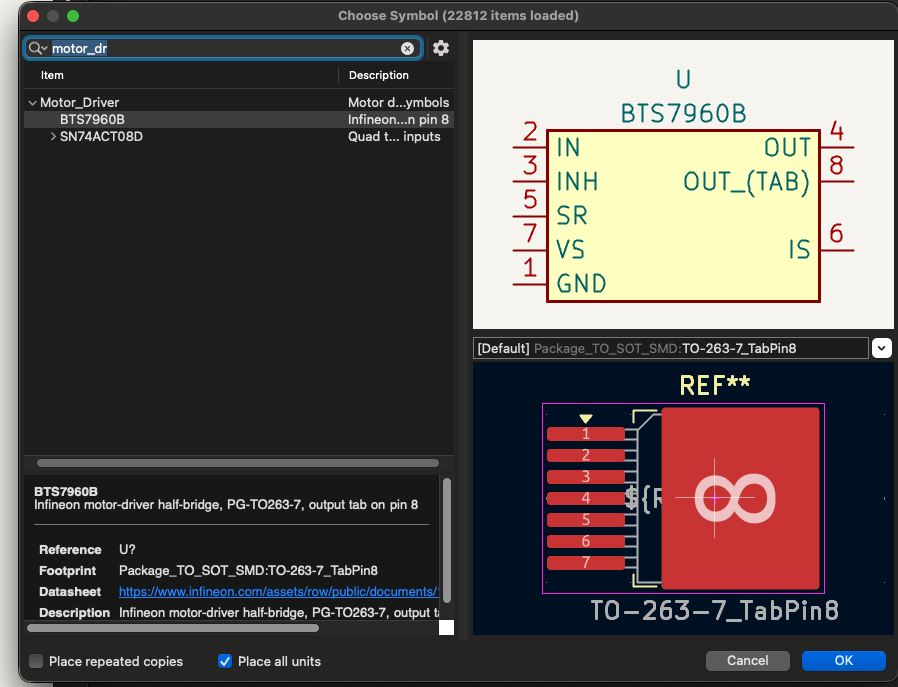
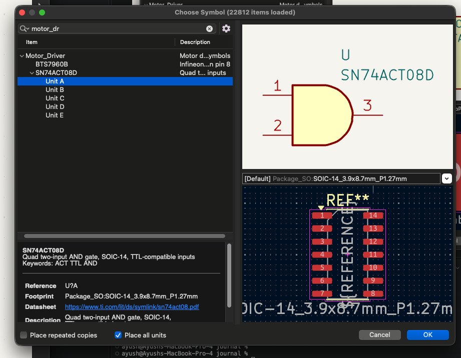

# Journal 01 — setting up the KiCad symbols

i set up a project library for the parts i needed for the motor driver  
the BTS7960B symbol shows OUT on pin 4 and the output tab on pin 8, with the TO-263 footprint assigned  
i checked the footprint preview to see the seven leads and the large tab pad

i also added the SN74ACT08D to the library for the PWM logic  
it shows up as four gate units and a separate power unit, all using one SOIC-14 footprint  
with both symbols showing in the picker i could start placing the parts for Motor A

