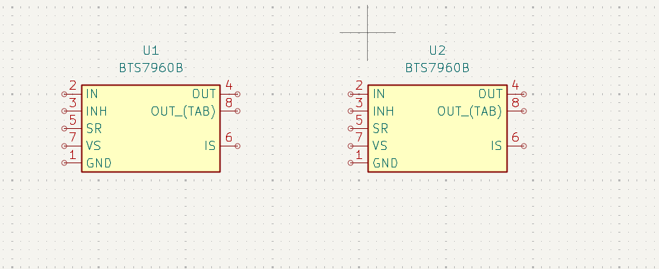
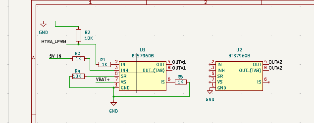
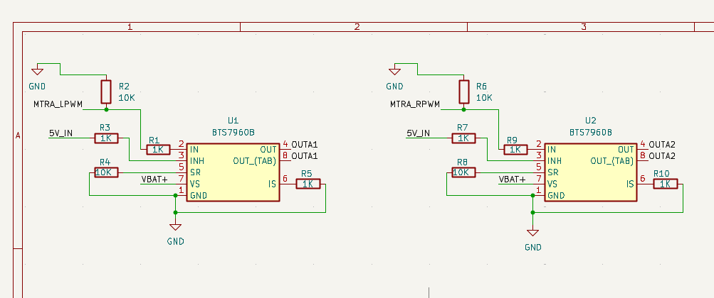
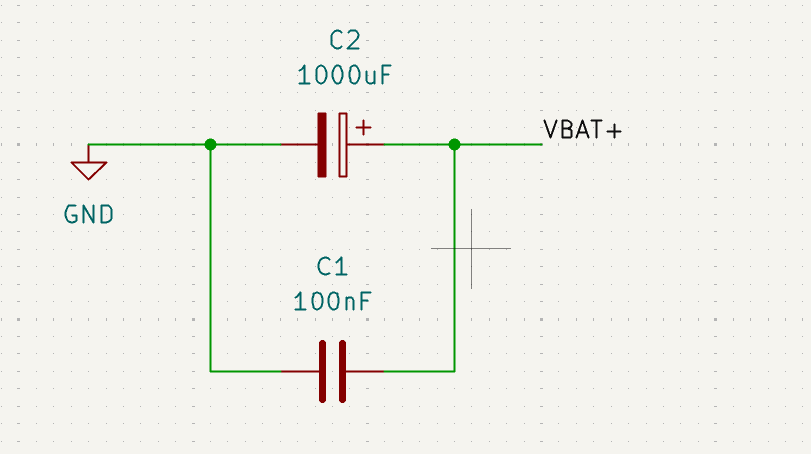
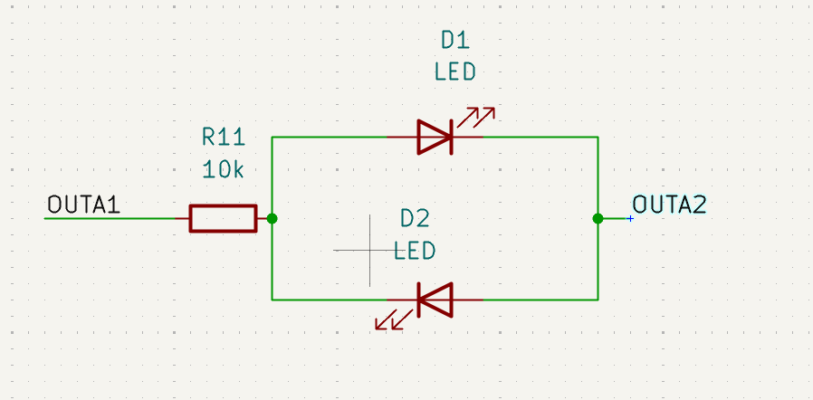
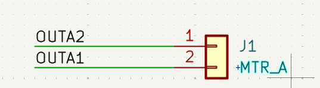
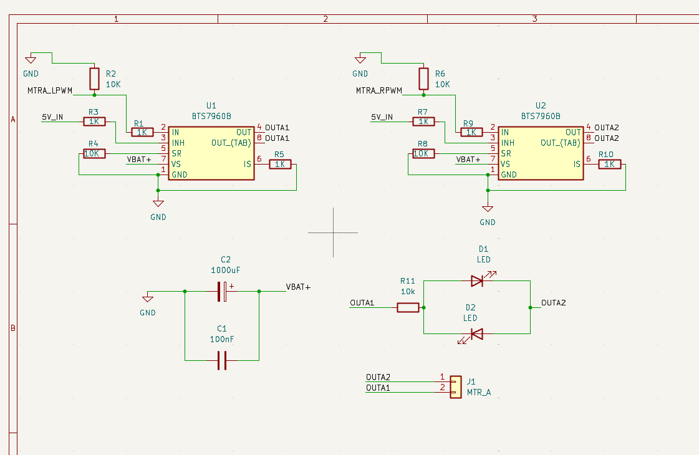

# Journal 02 — drawing the Motor A driver

i started the first motor channel in KiCad by placing two BTS7960B symbols from the project library  
each chip is one half of the bridge, so the motor will connect between the two outputs

i wired U1 first, with VBAT+ on VS and the ground pin tied to GND  
the MTRA_LPWM signal goes through a 1 kΩ resistor to IN, with a 10 kΩ pull-down on the signal  
INH goes to 5V_IN through 1 kΩ, and SR and IS each have their own resistor to ground

i repeated the wiring for U2 with MTRA_RPWM as its input  
pin 4 and the pin 8 tab share the same output net on each chip, OUTA1 for U1 and OUTA2 for U2  
the two output nets stay separate so they can go to opposite sides of the motor

i added a 1000 µF capacitor and a 100 nF capacitor across VBAT+ and GND for this channel  
the positive side of the 1000 µF capacitor goes to VBAT+

i added two LEDs facing opposite ways with a shared 10 kΩ resistor between the motor outputs  
the idea is to show which way the voltage is going across the motor by lighting a different LED for each direction

i added the two-pin motor connector as J1 and named it MTR_A  
pin 1 goes to OUTA2 and pin 2 goes to OUTA1

this is the Motor A section together, with the two drivers, supply capacitors, LEDs and output connector  
the PWM labels are ready for the AND gates, which still need to be added  
before copying this to the other channels i still need to check how the bridge behaves at startup and at zero PWM with INH pulled high, then run the schematic checks

