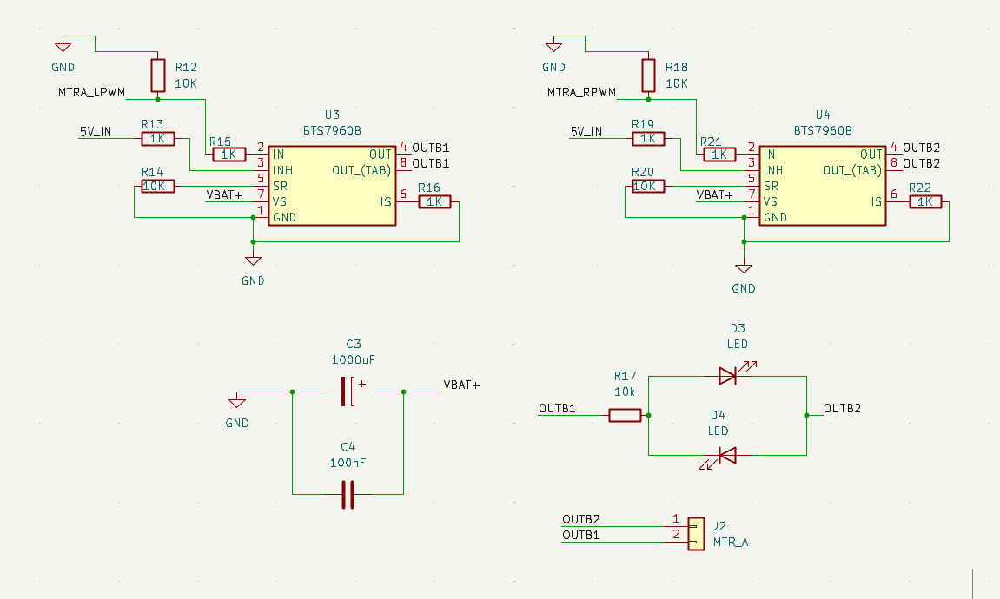
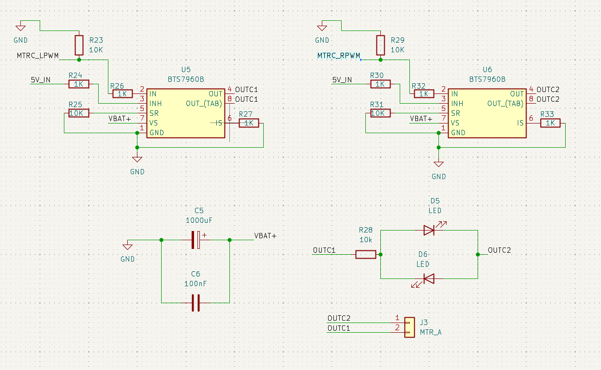
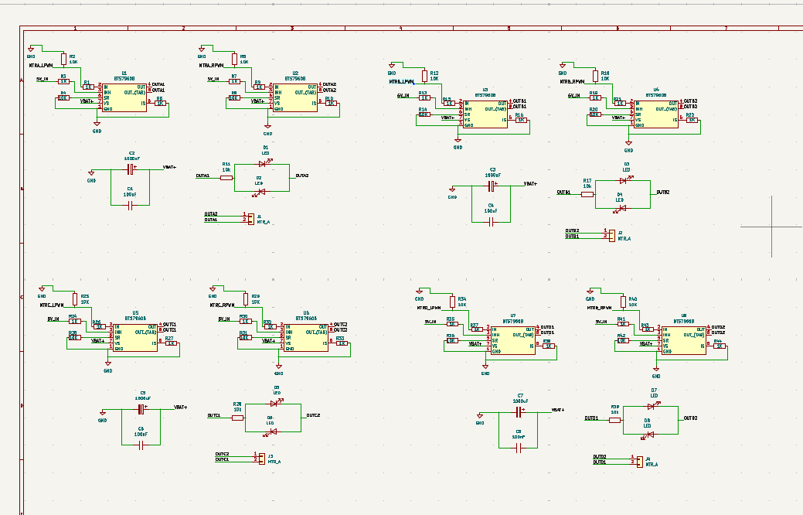

# Journal 03 — copying Motor A to the other channels

i copied the Motor A driver to start Motor B  
the new pair is U3 and U4, with OUTB1 and OUTB2 going to the LEDs and the J2 connector  
in this first screenshot the inputs still say MTRA_LPWM and MTRA_RPWM from the copy, so those labels needed changing to keep the two channels separate

then i made Motor C with U5 and U6  
i used MTRC_LPWM and MTRC_RPWM for its inputs and OUTC1 and OUTC2 for the two motor outputs  
i kept the same 1000 µF and 100 nF capacitors across VBAT+ and GND, plus the two LEDs across the motor outputs

i added Motor D with U7 and U8 and zoomed out to see all four driver blocks together  
the latest KiCad history copy shows separate PWM labels for A, B, C and D, with eight half-bridges in total  
the connectors are J1 to J4, but their displayed values still say MTR_A, so J2 to J4 need the right names before the next review

the power labels are shared across the four blocks, and each motor has its own pair of output nets  
next i need to save the latest schematic, add the PWM and direction logic, and check the wiring before moving to the PCB
