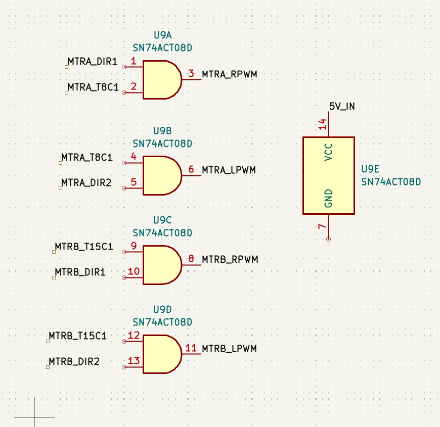
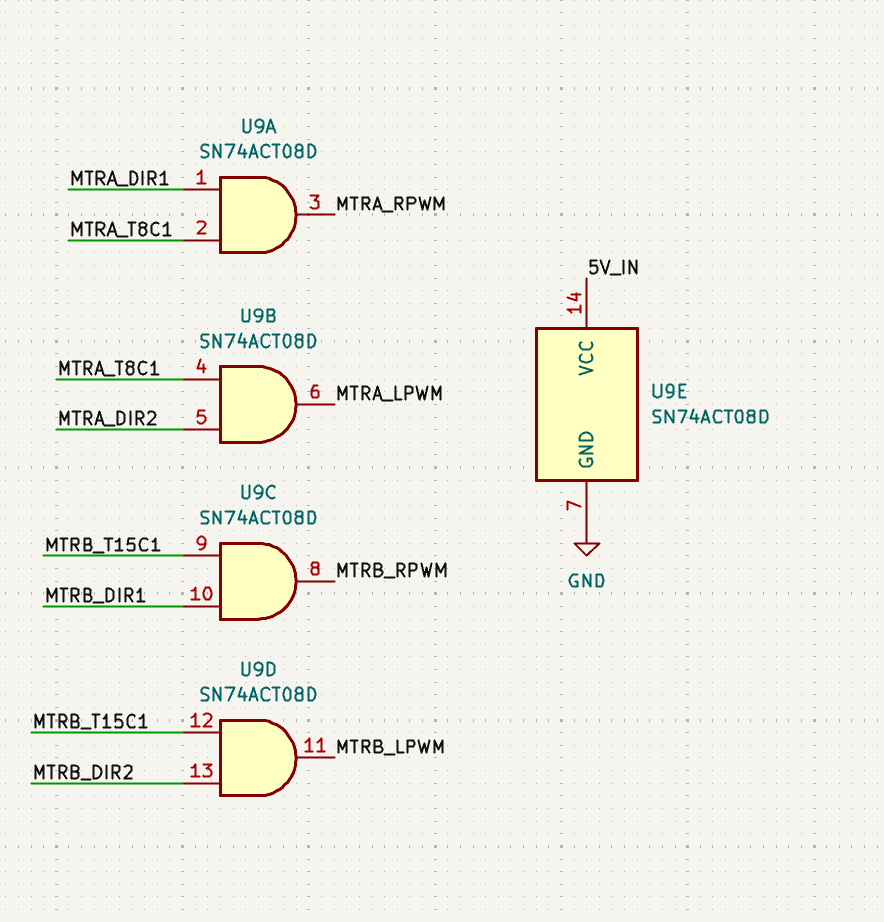
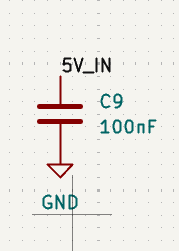
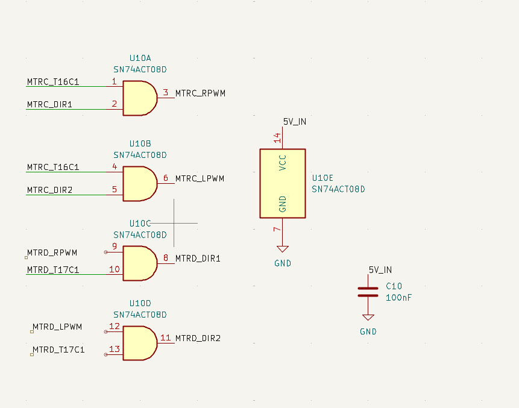
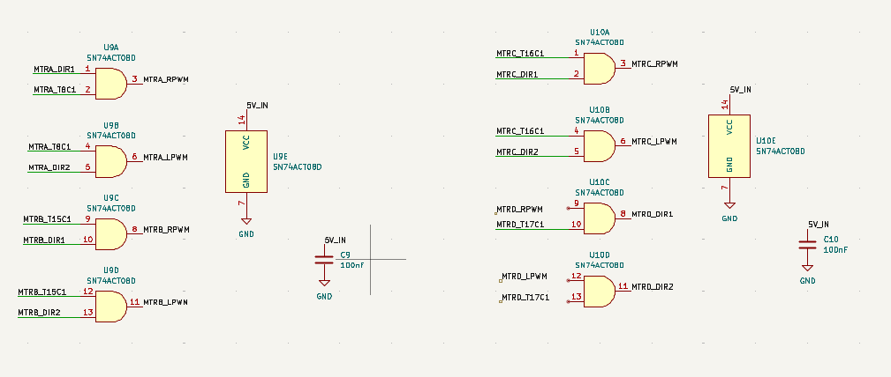

# Journal 04 — adding the PWM and direction logic

i added the first SN74ACT08D as U9 for motors A and B  
KiCad shows the four AND gates as units A to D, and the power pins as unit E  
the five units all belong to the same chip

i wired the two Motor A gates to the same timer signal, MTRA_T8C1  
DIR1 goes to the gate that makes MTRA_RPWM, and DIR2 goes to the gate that makes MTRA_LPWM  
i did the same for Motor B with MTRB_T15C1 and its own direction labels, then connected pin 14 to 5V_IN and pin 7 to GND

i added C9, a 100 nF capacitor across 5V_IN and GND, for the U9 power supply  
when i get to the PCB, it needs to sit close to the chip's power pins

i added U10 for motors C and D, with another 100 nF capacitor, C10  
Motor C uses MTRC_T16C1 for both gates and has separate DIR1 and DIR2 inputs  
in this screenshot the Motor D labels are still being placed, and DIR and PWM output labels are swapped on units C and D

i zoomed out to see both chips and both supply capacitors together  
before moving on i need to check that Motor D's timer and DIR signals go to the inputs, with MTRD_RPWM on pin 8 and MTRD_LPWM on pin 11  
then i can check that all eight PWM outputs match the labels on the motor driver inputs

