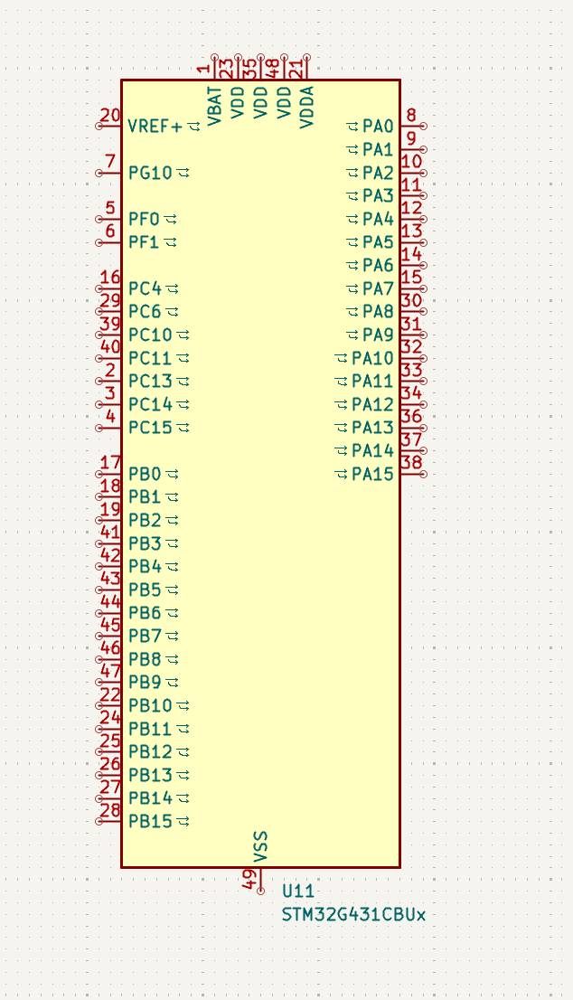
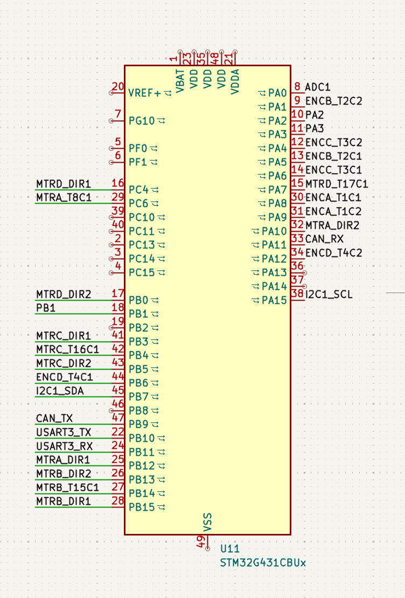
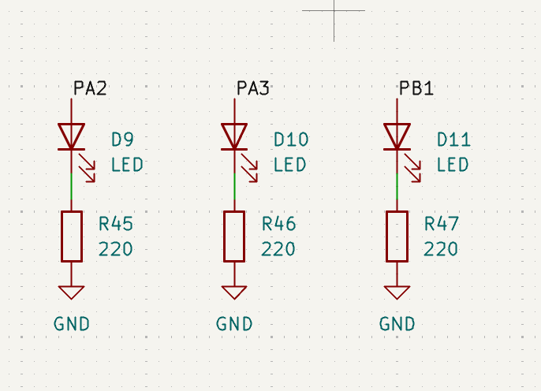
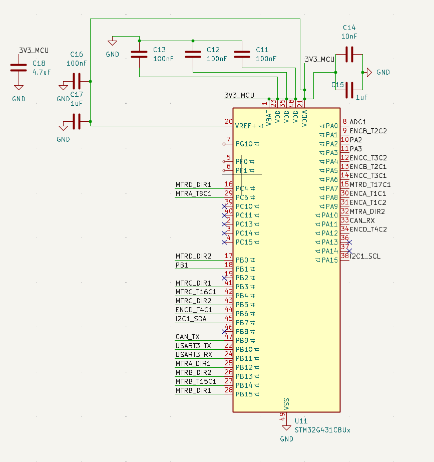
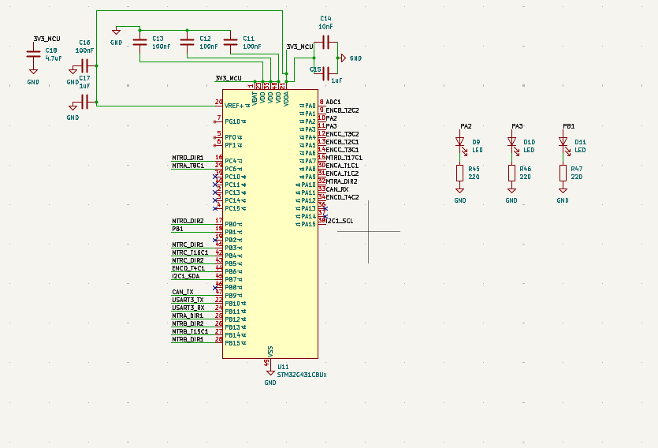

# Journal 05 — wiring the STM32 and its 3.3 V supply

i placed the bare STM32G431CBUx symbol as U11  
the reference uses a WeAct module, so i had to match the signals by GPIO name and draw the power wiring for the chip itself

i added the labels for the four PWM timer outputs, direction signals and encoder pairs  
i also labelled PA0 for battery voltage sensing, PA11 and PB9 for CAN, PB10 and PB11 for USART3, and PA15 and PB7 for I2C1  
the power pins were still open at this point

i drew three status LEDs on PA2, PA3 and PB1  
each LED has its own 220 Ω resistor to GND so the MCU can control them separately

i connected the three VDD pins and the STM32 backup supply pin to 3V3_MCU  
i added a 100 nF capacitor for each VDD pin and one shared 4.7 µF capacitor  
VDDA uses the same 3.3 V rail with 10 nF and 1 µF to ground, and VREF+ is tied to VDDA with its own 100 nF and 1 µF pair  
i also connected VSS, the exposed pad numbered 49, to GND

this view shows the STM32 and the status LEDs together  
the 3V3_MCU label still needs its regulator supply elsewhere in the schematic  
before moving on i need to make room for an SWD header, since PA13 and PA14 are marked unused here, and bring PG10 out for reset

