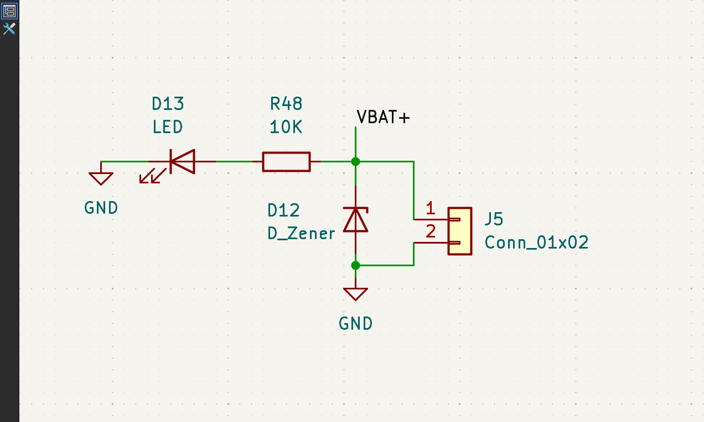
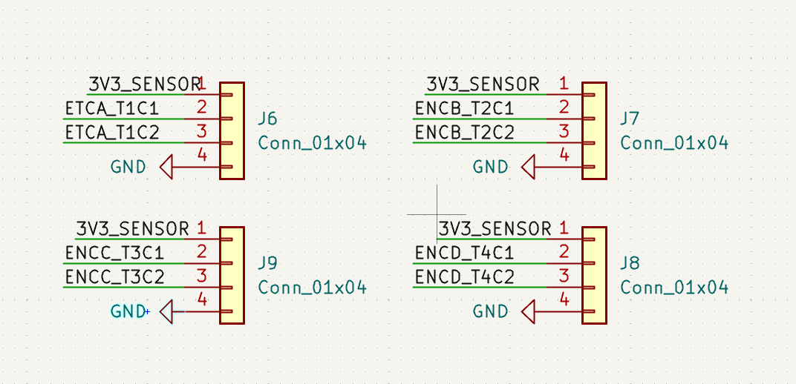
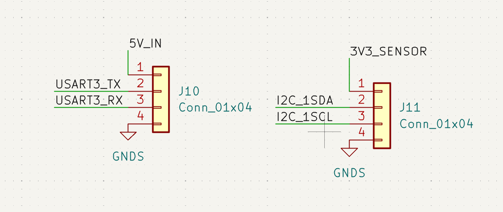
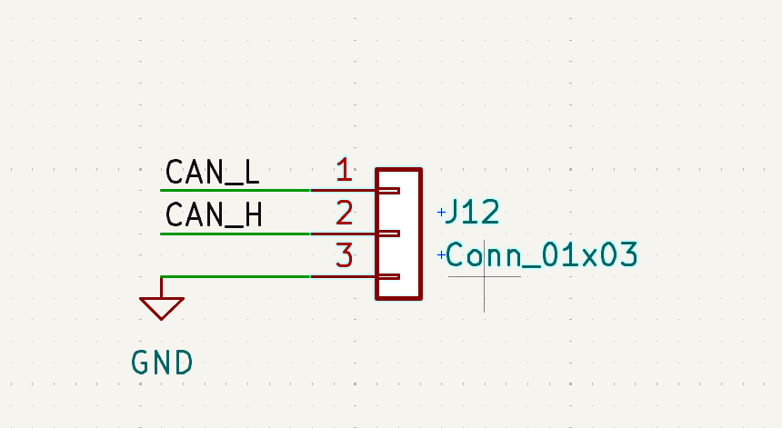
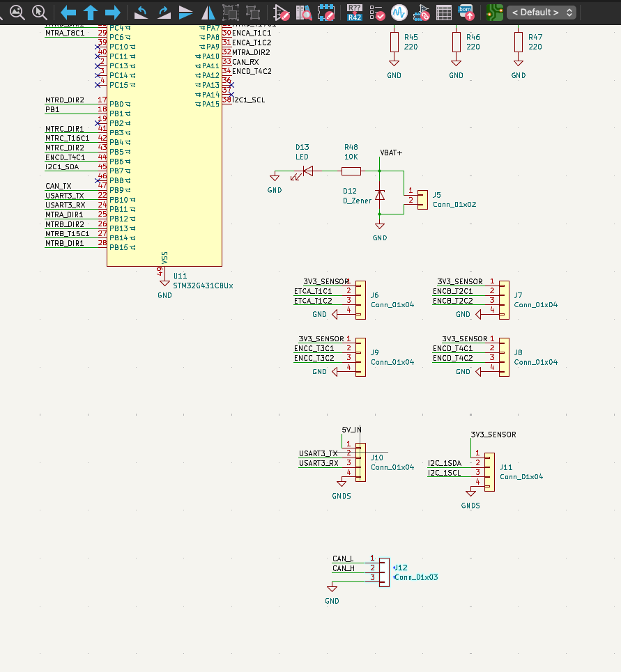

# Journal 06 — adding the battery input and signal headers

i drew the motor battery input with J5 pin 1 on VBAT+ and pin 2 on GND  
i added D12 across the supply for the TVS, with its cathode on VBAT+, and a power LED with a 10 kΩ resistor  
D12 still shows the generic diode value here, the intended part is SMBJ18A

i added four encoder connectors, each with 3V3_SENSOR on pin 1, the two encoder signals on pins 2 and 3, and GND on pin 4  
Motor A’s connector labels still read ETCA instead of ENCA in this view, so they need to match the STM32 labels

i drew the USART3 and I2C headers with a supply pin, two signal pins and a return pin  
the I2C labels still need to match I2C1_SDA and I2C1_SCL on the MCU, and both headers show GNDS, which needs to be joined to the common GND for this design

i added J12 with CAN_L on pin 1, CAN_H on pin 2 and GND on pin 3  
this is the bus connector, the transceiver connection comes next

i checked how the battery input and the signal headers sit beside the STM32 block  
this shows where the new blocks fit on the sheet and which nets still need checking

