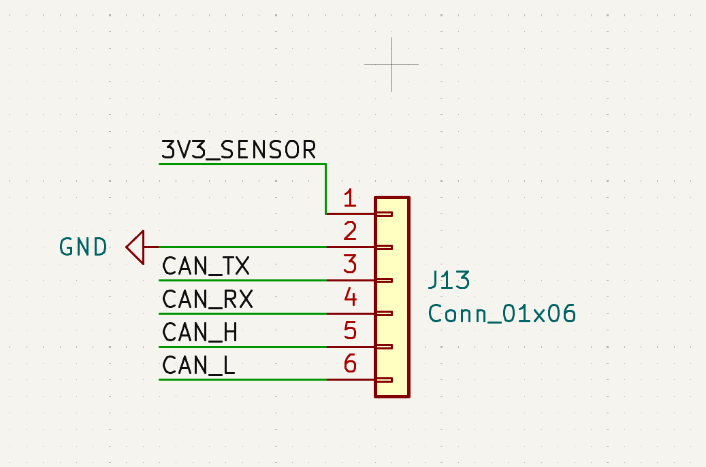
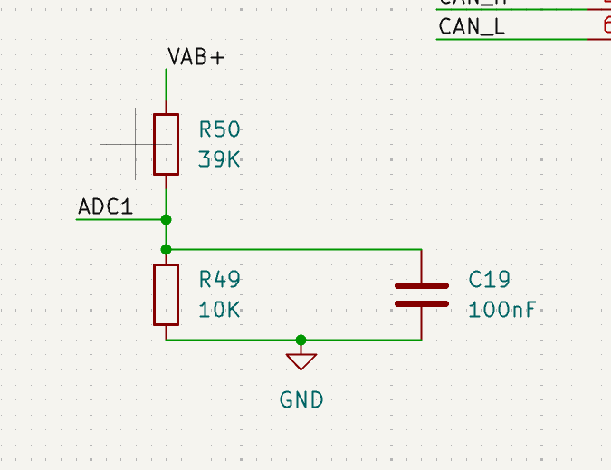
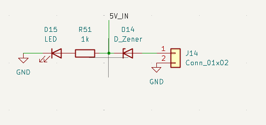
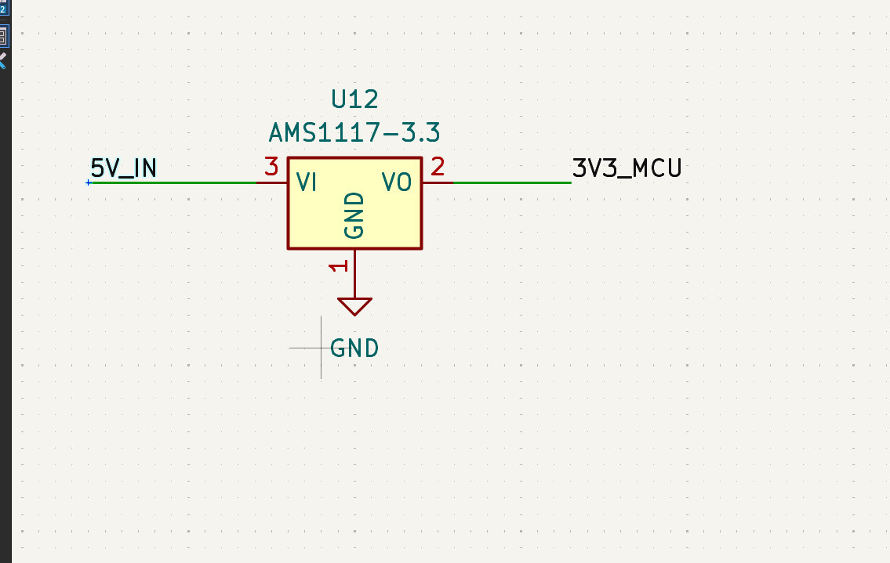
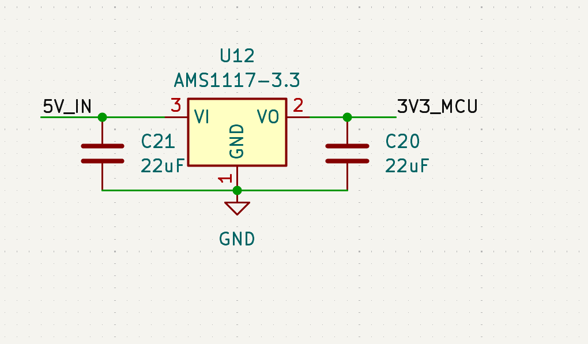
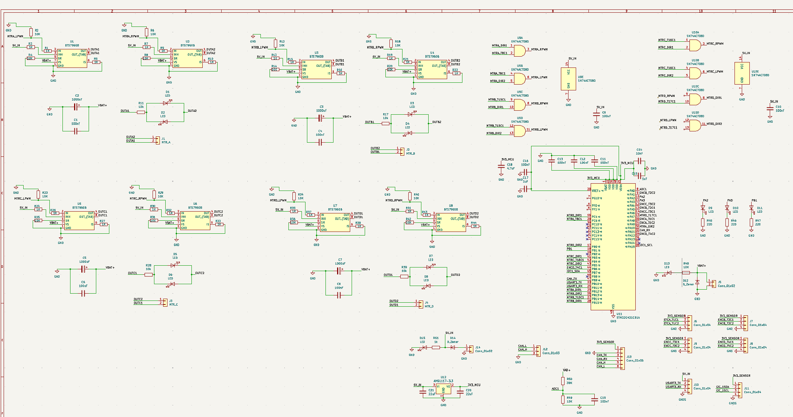

# Journal 07 — adding the CAN module header and power circuits

i added J13 as a six-pin header for a CAN transceiver module  
it has 3V3_SENSOR, GND, CAN_TX, CAN_RX, CAN_H and CAN_L  
the module still needs to be picked and its pin order checked

i made the battery sense divider with 39 kΩ on top, 10 kΩ to ground and 100 nF across the lower resistor  
the midpoint goes to ADC1 on PA0, the top label says VAB+ in this screenshot and needs to be VBAT+ to reach the battery rail

i drew J14 for the separate 5 V logic input, with D14 in series and a power LED through 1 kΩ  
D14 is still shown as a generic diode symbol, the reference uses a Schottky here

i added the AMS1117-3.3 with 5V_IN on pin 3, 3V3_MCU on pin 2 and GND on pin 1  
this gives the bare STM32 a separate regulated rail from the motor battery

i added one 22 µF capacitor from each side of the regulator to ground  
i still need to choose the output capacitor for the exact regulator and check the input voltage left after the series diode

i zoomed out to see the motor drivers, gate logic, STM32 and all the new connectors and supply blocks together  
the motor connectors are now named MTR_A through MTR_D  
this is the full schematic draft, i still need to power 3V3_SENSOR, fix the net names, check Motor D’s gate inputs and outputs, and add SWD before running the final electrical rules check

