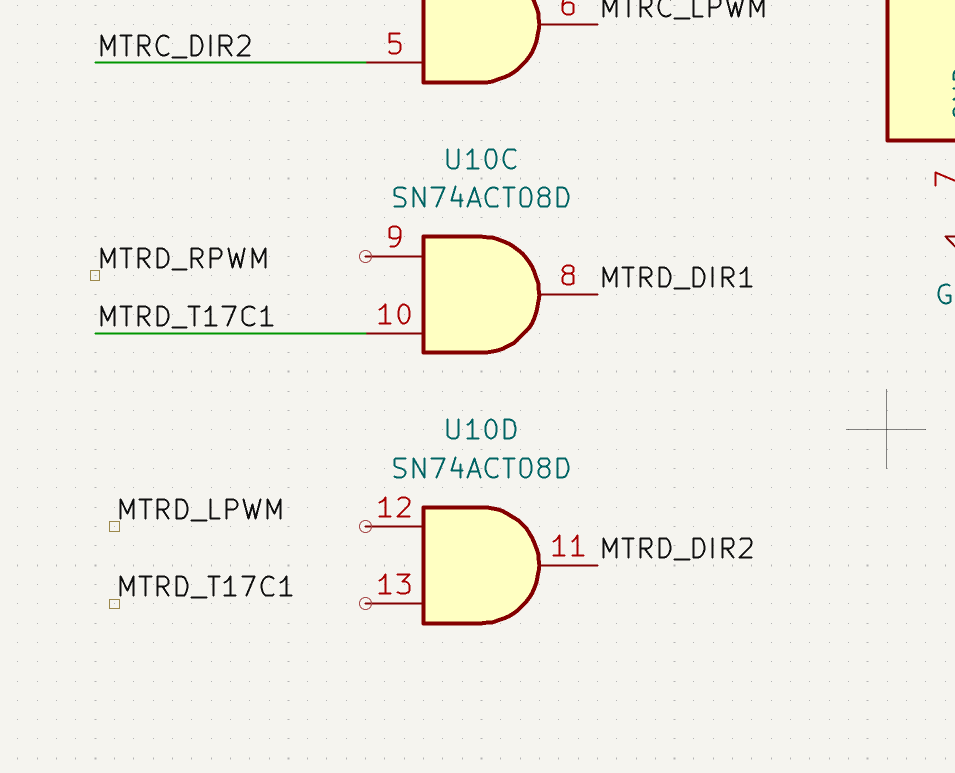
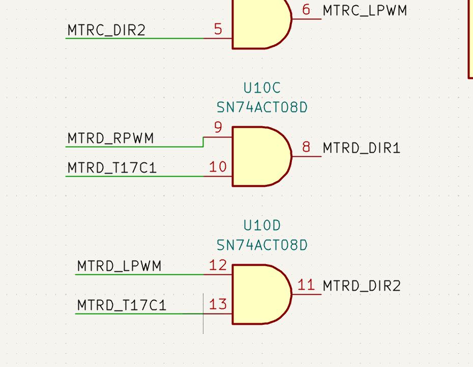
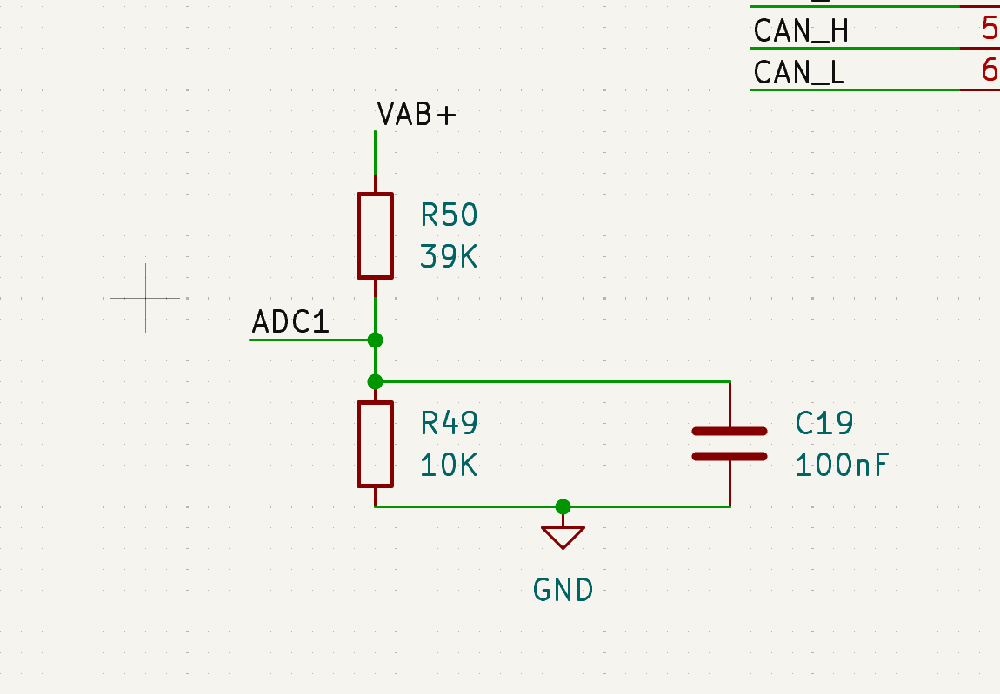
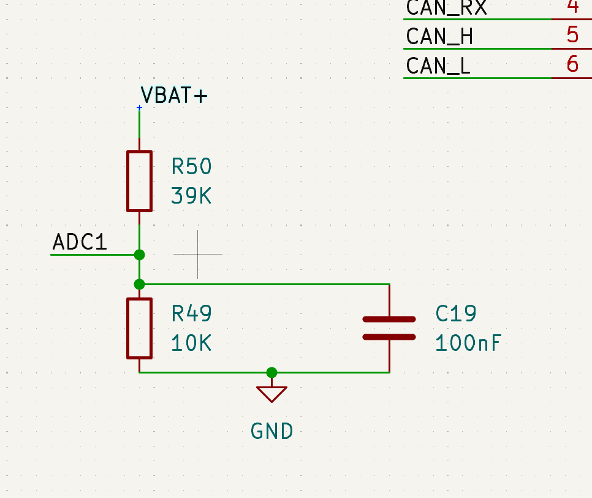
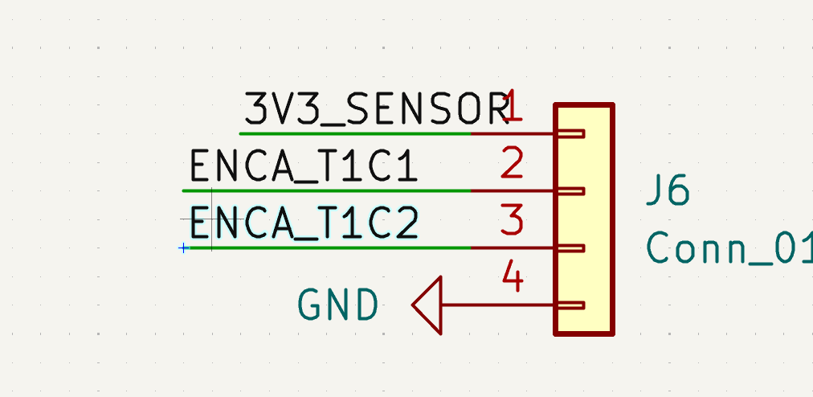
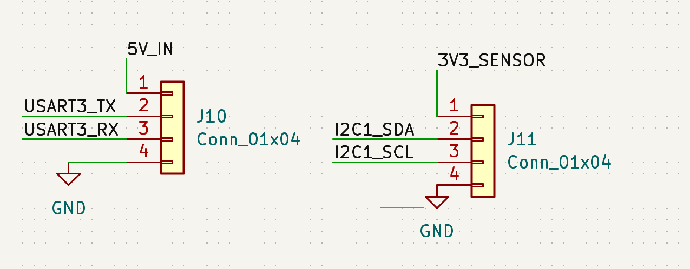
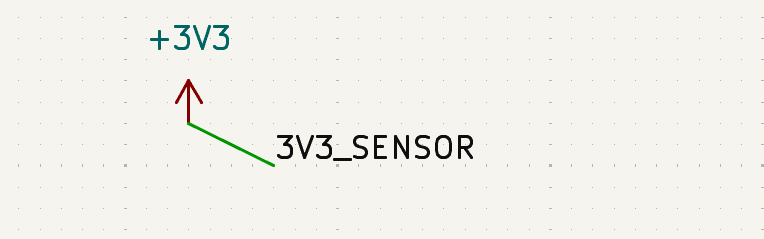

# Journal 08 — cleaning up the schematic connections

i went back to the open connections and label typos from the last schematic review  
i started with Motor D, where some of the labels were still sitting away from the AND gate pins

i drew the missing input wires on U10C and U10D  
this view still has the DIR and PWM labels on the wrong sides, so the wiring needs another pass  
DIR1 and DIR2 should each go into a gate along with MTRD_T17C1, then MTRD_RPWM should come out of pin 8 and MTRD_LPWM out of pin 11

i checked the battery divider next and found that the top label said VAB+  
that name did not match the VBAT+ rail used by the battery input

i changed it to VBAT+ so the top of the divider uses the motor battery net  
the 39 kΩ and 10 kΩ resistors and the 100 nF capacitor stayed in place around the ADC1 node

i fixed the Motor A encoder header labels from ETCA to ENCA  
J6 now uses ENCA_T1C1 and ENCA_T1C2, the same names as the STM32 pins

i also matched the I2C header to I2C1_SDA and I2C1_SCL on the MCU  
both the USART and I2C headers now use the common GND symbol instead of GNDS

i added a +3V3 symbol to the 3V3_SENSOR net  
the regulator output is still called 3V3_MCU, so i need to connect the sensor net to that output if both are meant to use U12  
the latest changes are visible in the KiCad history copy, i still need to save the main schematic and run the electrical rules check after the remaining fixes

