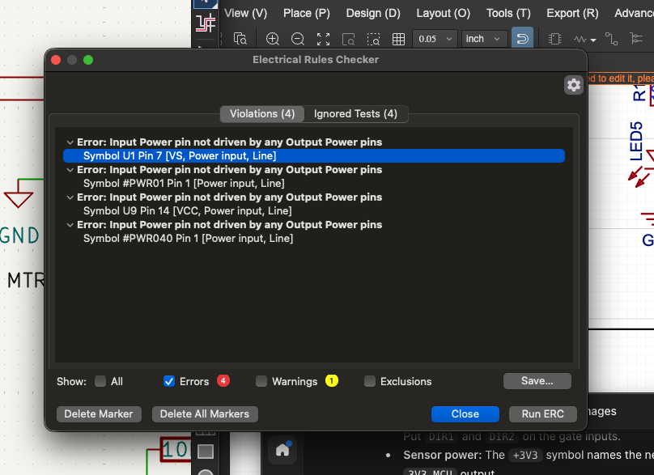
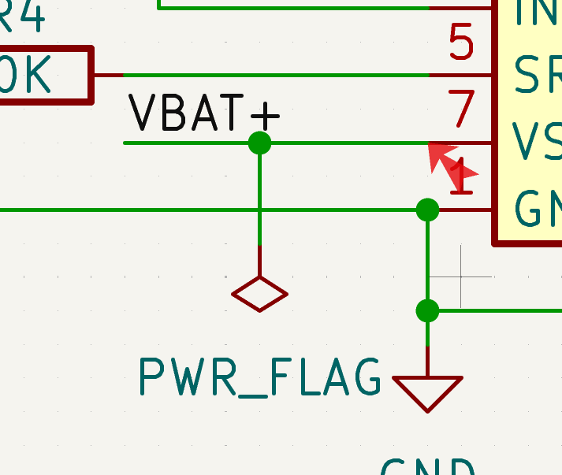
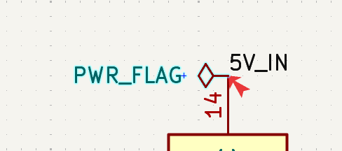
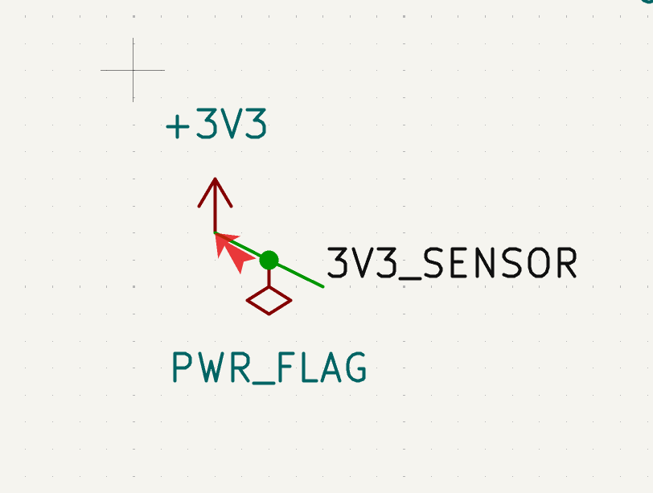
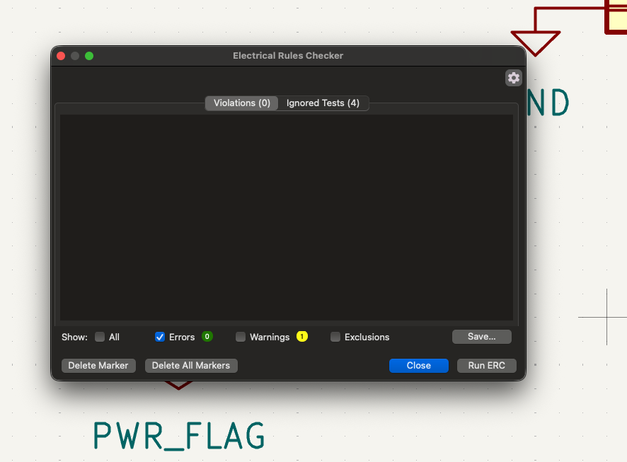

# Journal 09 — fixing the ERC power errors

after fixing the Motor D gates, i ran the electrical rules checker in KiCad  
the first run showed four errors for power inputs that KiCad could not see a source for, plus one warning  
two of the errors pointed to the first motor driver's VS pin and the first AND chip's VCC pin

i added a PWR_FLAG to VBAT+ so KiCad knows the motor rail is fed through the external battery connector

i also added a flag on 5V_IN, the rail fed through the logic supply connector and its series diode

i added a flag where +3V3 and 3V3_SENSOR meet  
a flag tells KiCad to treat the net as powered for ERC, the sensor rail still needs a real supply connection on the schematic

i ran ERC again and the error count went from four to zero  
the bottom of the window still shows one warning, and the ignored tests tab shows four checks, so i still need to review those before calling the schematic finished

