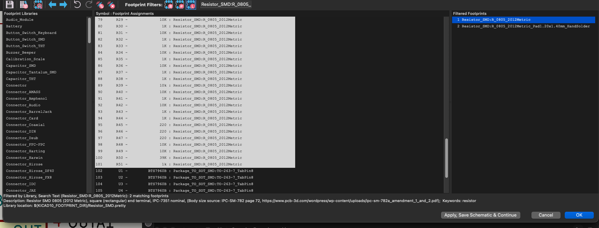
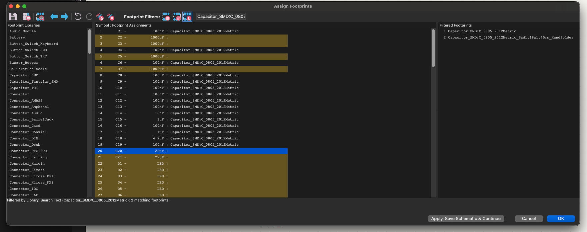
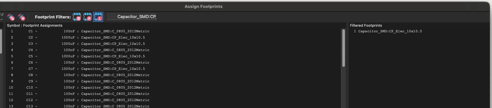
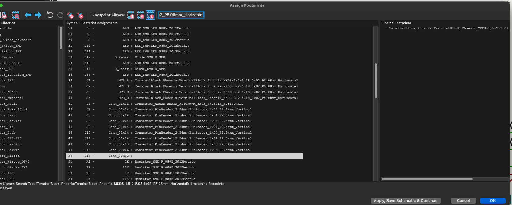
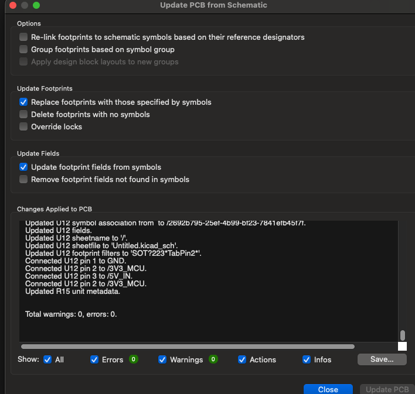
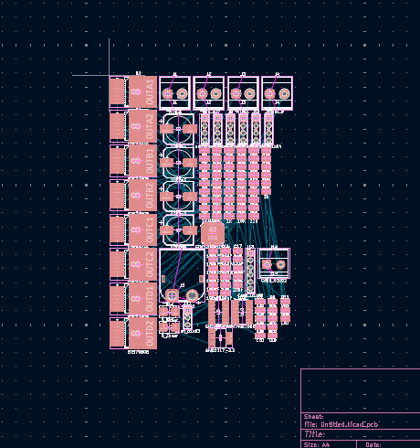
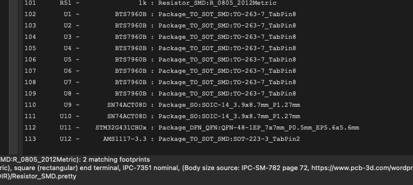

# Journal 10 — assigning footprints and importing the PCB

i assigned the 0805 footprint to the resistors in batches, including the small resistors around the drivers and the LEDs

i used 0805 footprints for the small capacitors and kept the large polarized caps in a separate group

i assigned CP_Elec_10x10.5 to the four 1000 µF motor supply capacitors, the actual capacitor bodies still need to match this footprint

i picked the screw terminals for the motors, the XT60 for the battery input and 2.54 mm headers for the signals  
i also assigned the diode and LED footprints, and looked up the 5.08 mm screw terminal for the logic input

i updated the PCB from the schematic and the import window showed zero warnings and zero errors  
this was the footprint import result, the routing and board checks come later

the footprints came in stacked into groups with thin lines showing what needs connecting  
i had 113 footprints in the PCB file and needed to spread them out before routing

i kept the TO-263 footprints with pad 8 as the output tab for the eight BTS7960B chips  
the gate chips use SOIC-14, the STM32 uses QFN-48 with an exposed pad and the regulator uses SOT-223 with the tab on pin 2

