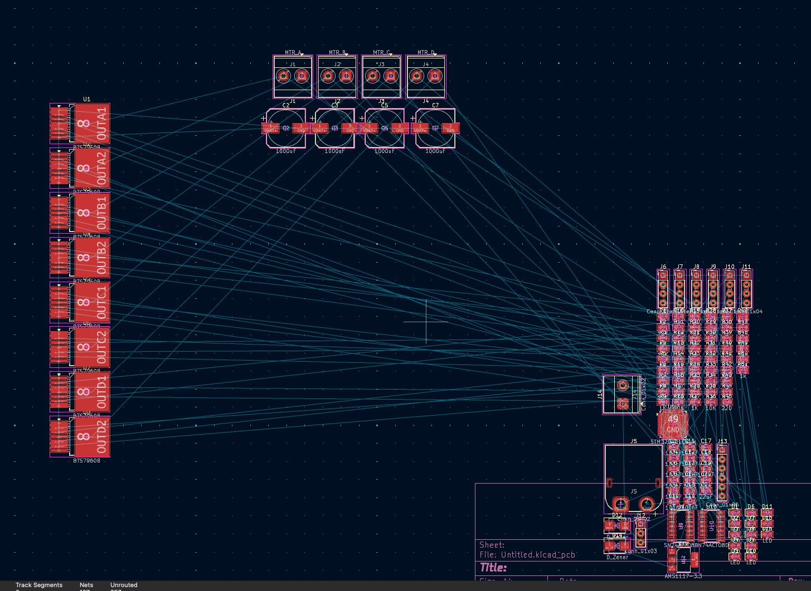
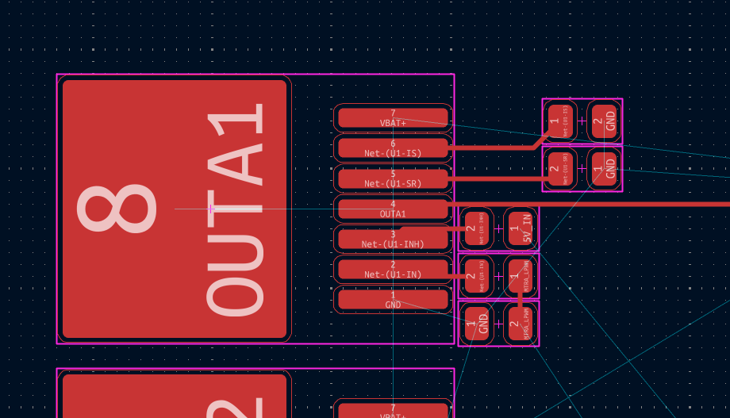
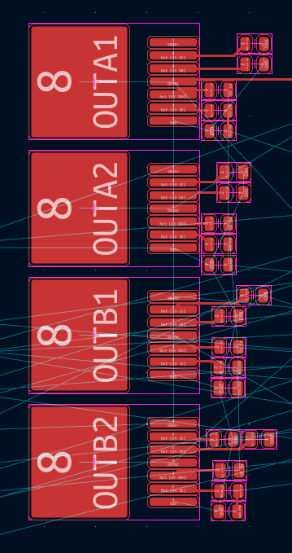
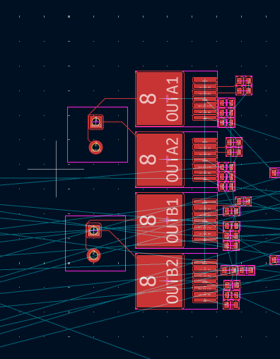
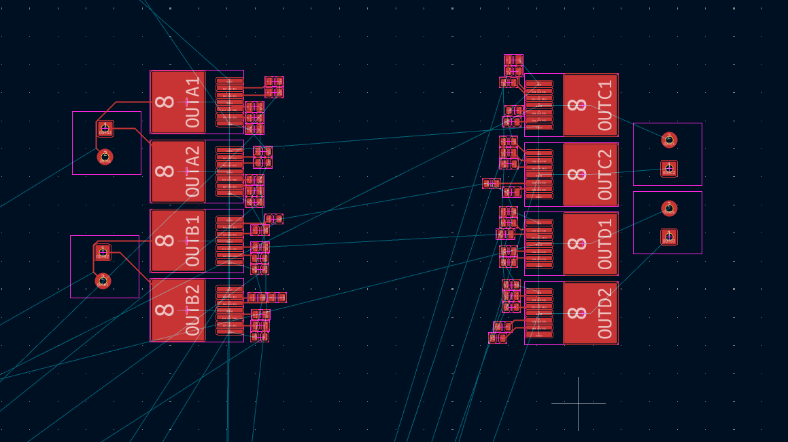
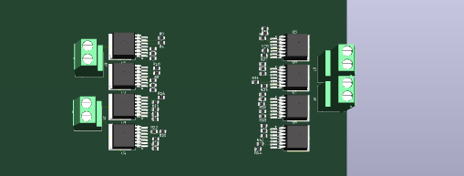

# Journal 11 — placing the motor drivers and starting the tracks

i spread the imported parts out so i could move the driver chips, motor terminals and large caps as separate groups  
most of the connections were still just thin guide lines at this stage

i put the small resistors close to U1 and started routing the short tracks between its pins and the resistor pads  
the big pad on the left is OUTA1, which is separate from VBAT+ and ground

i repeated the close resistor placement for the other driver footprints, keeping the parts near the pins they connect to

i moved the Motor A and B terminals to the outside edge near their driver pairs and started joining the output pads to the terminals

i arranged A and B on the left and C and D on the right, with their motor terminals facing out  
this left space in the middle for the controller and the signal connectors

i opened the 3D view to see the two driver banks and how the screw terminals sit along the edges  
this was a placement preview while plenty of tracks were still left to route

