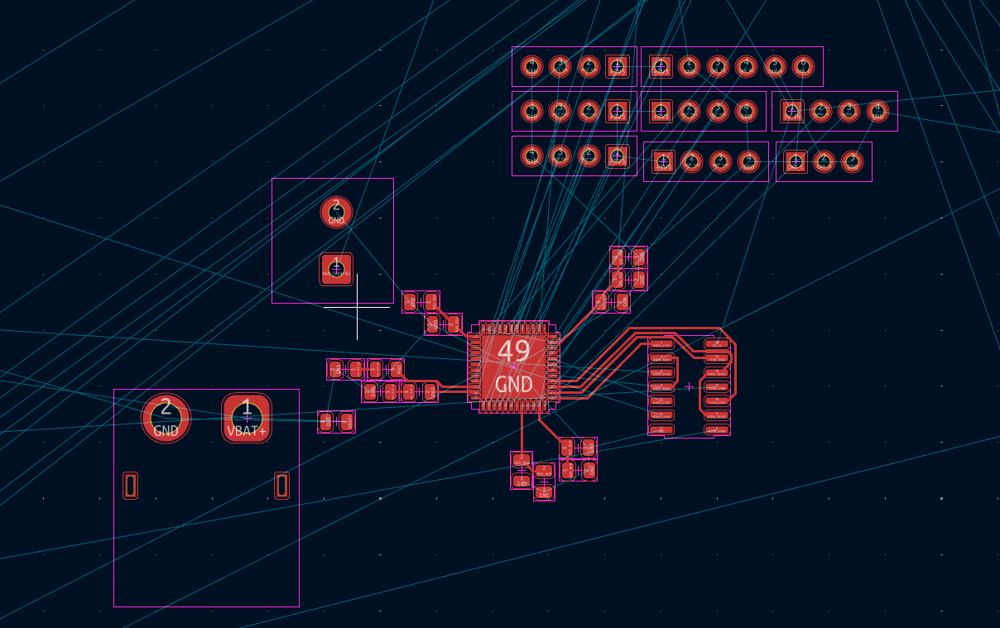
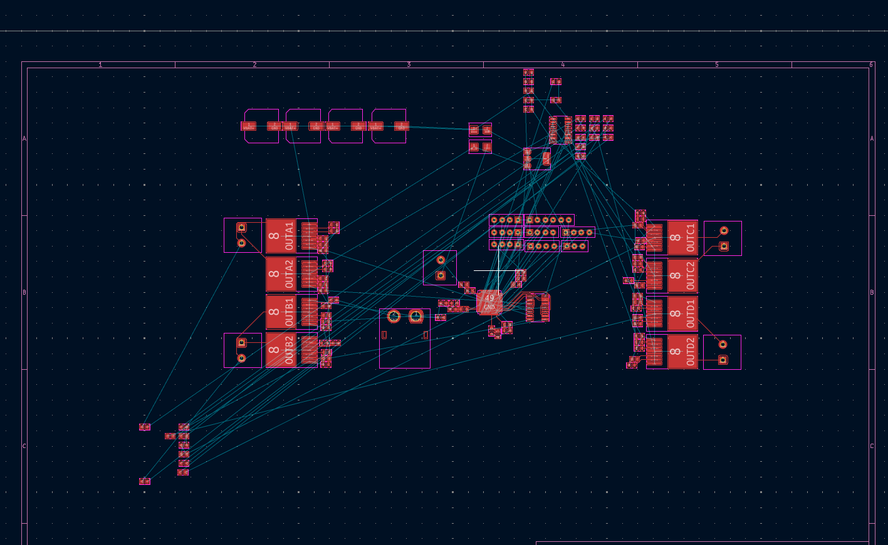
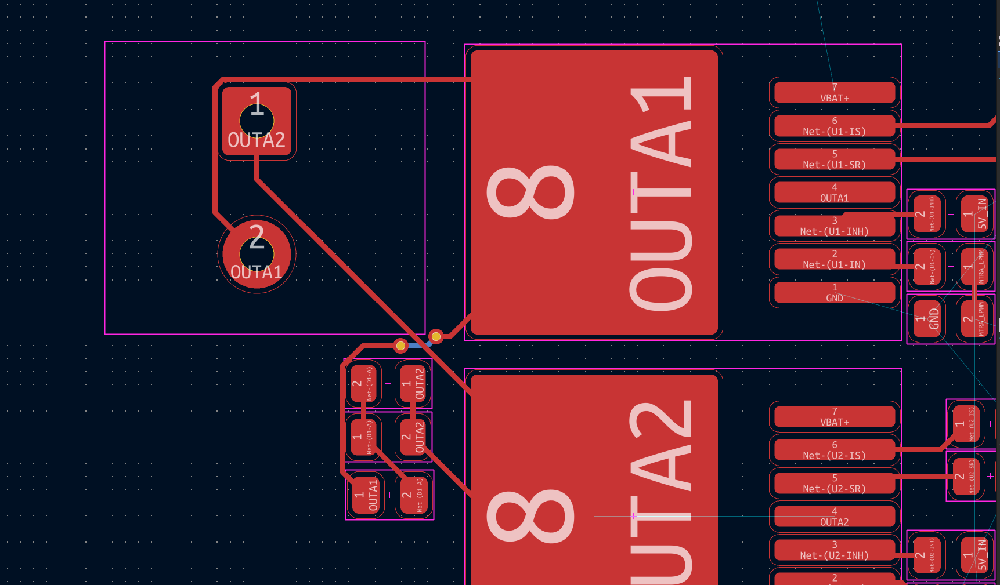
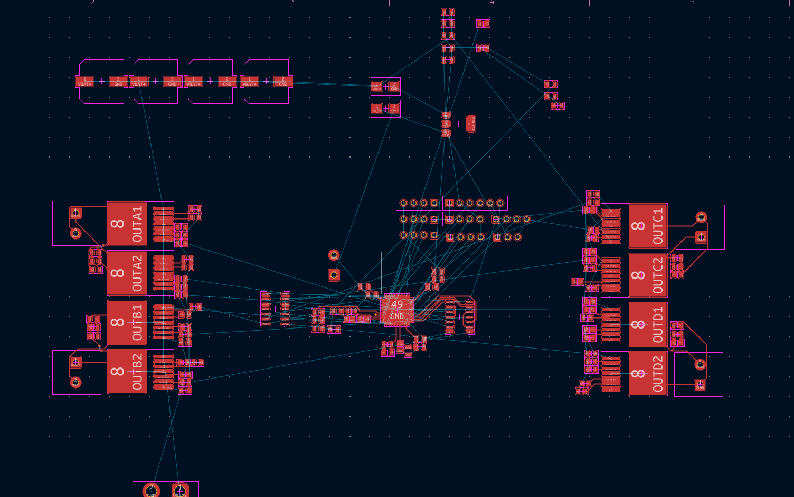

# Journal 12 — placing the STM32 and routing motor outputs

i put the STM32 near the middle and brought its small capacitors and one of the AND chips close to it  
i started running tracks out of the QFN pins toward the logic chip while the header nets were still waiting

i zoomed out to check where the two driver banks and central parts sat together  
the guide lines helped show which groups still needed moving closer or routing

i worked on the Motor A connector and its LED network near U1 and U2  
the two terminal pads are OUTA2 and OUTA1, and the tracks lead back to separate output nets

the wider view shows tracks at the motor terminals on both sides and around the controller  
i still had connections to finish between the centre and the outer driver groups

