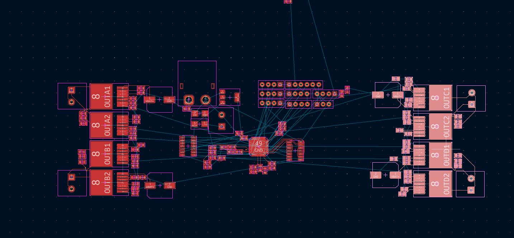
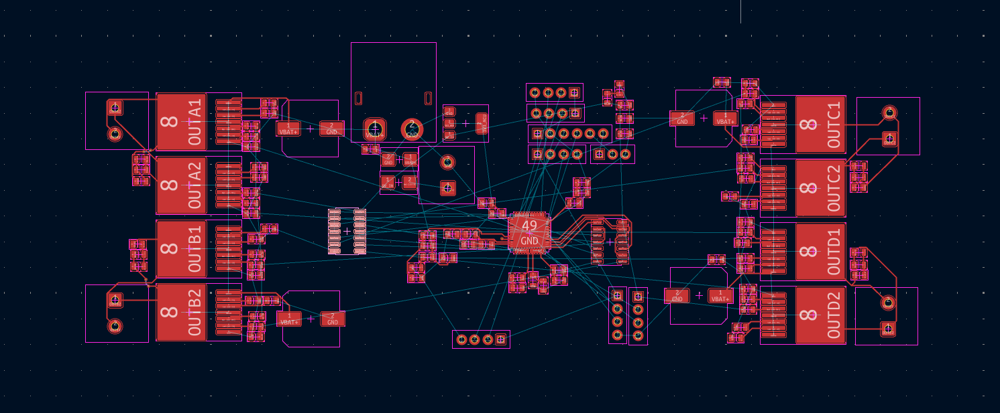
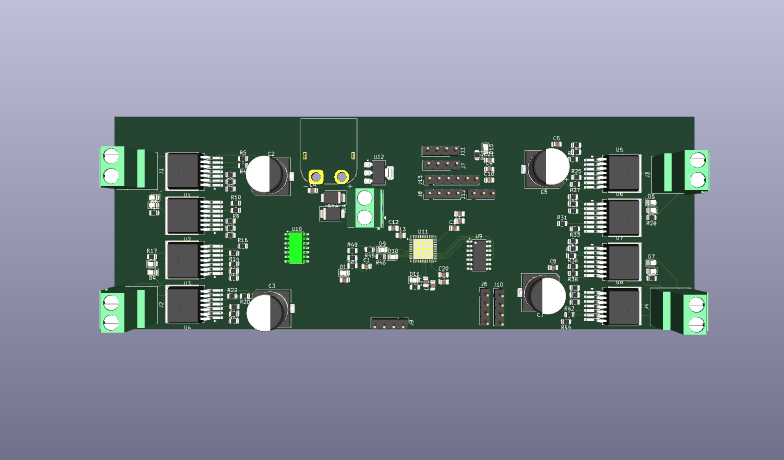
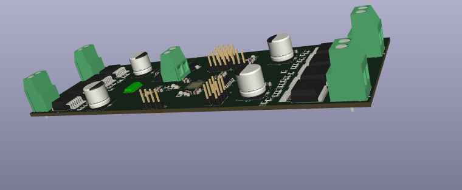

# Journal 13 — tightening the placement and checking it in 3D

i moved the large capacitors closer to their driver groups and brought the battery input into the middle area

i moved the headers and small control parts into the space between the left and right motor sections  
this view still shows guide lines between the controller, headers and drivers

i checked the top view with the motor terminals, four large caps and the small headers in place  
the STM32 footprint is near the middle, away from the outer motor connectors

i tilted the board to see how tall the screw terminals, bulk capacitors and headers are  
this helps when thinking about cable access and room above the PCB

