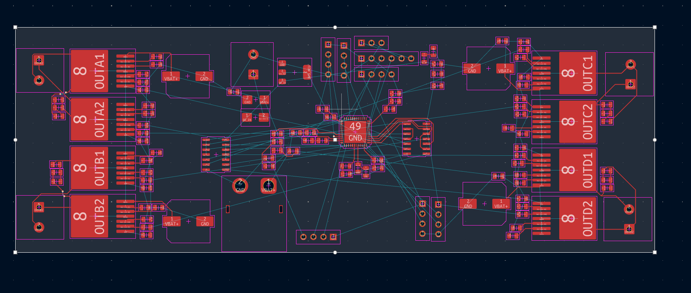
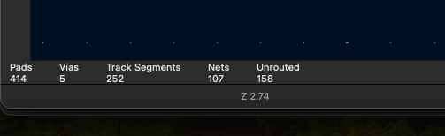
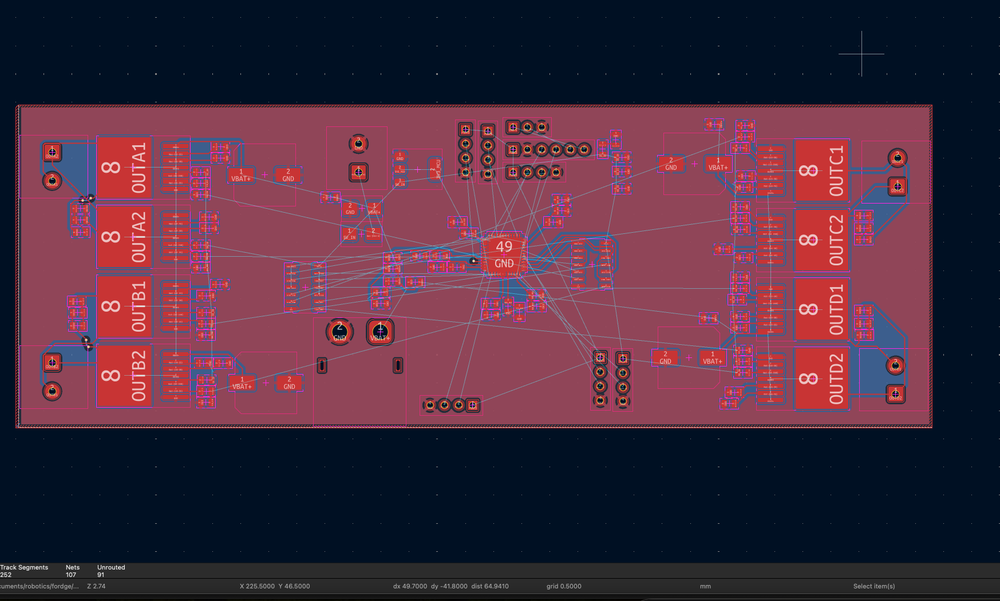
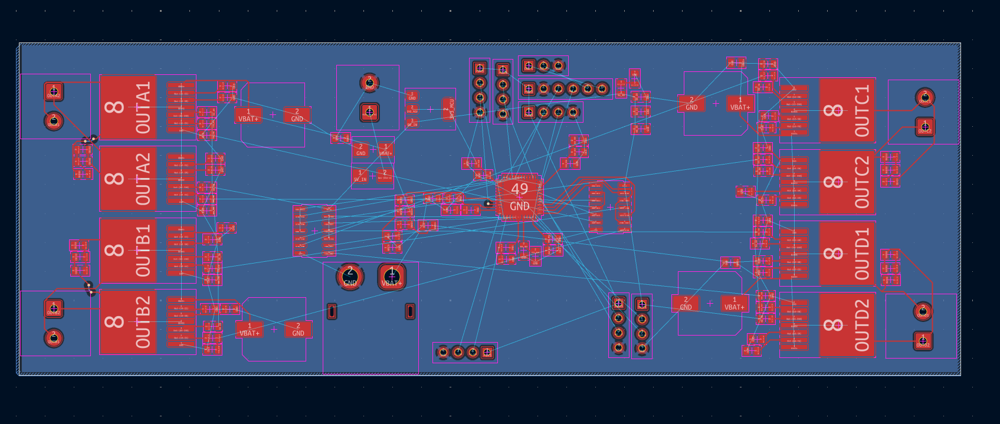
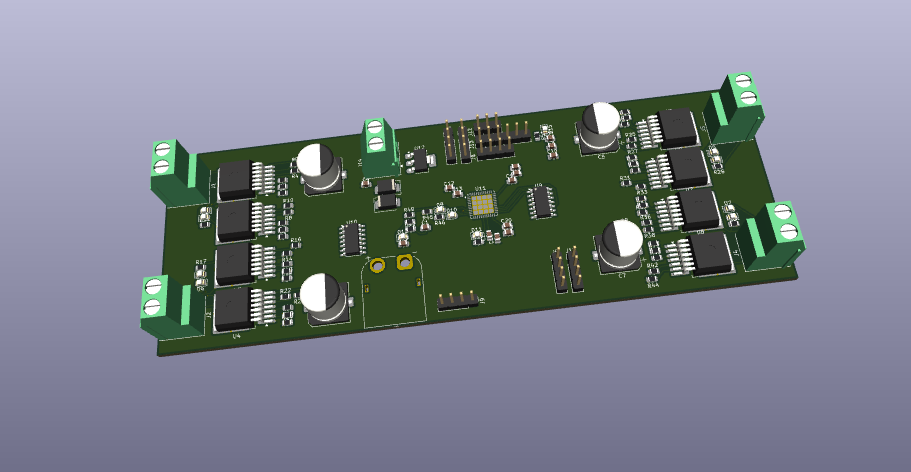

# Journal 14 — adding the outline and checking routing progress

i drew the rectangular board outline around the placed parts and checked where the motor terminals sit near the edges

the KiCad counter showed 414 pads, 107 nets, 252 track segments and 5 vias  
there were still 158 unrouted connections at this point

i filled copper around the layout and checked the counter again  
it showed 91 unrouted connections, down by 67, with the same 252 track segments  
the fill connects some pads through copper zones, so the change is not 67 extra hand routed tracks

i switched to the back copper view to look at how the fill sits around the pads and board outline

i looked at the board in 3D again to check the outline against the four motor terminals and the central parts

