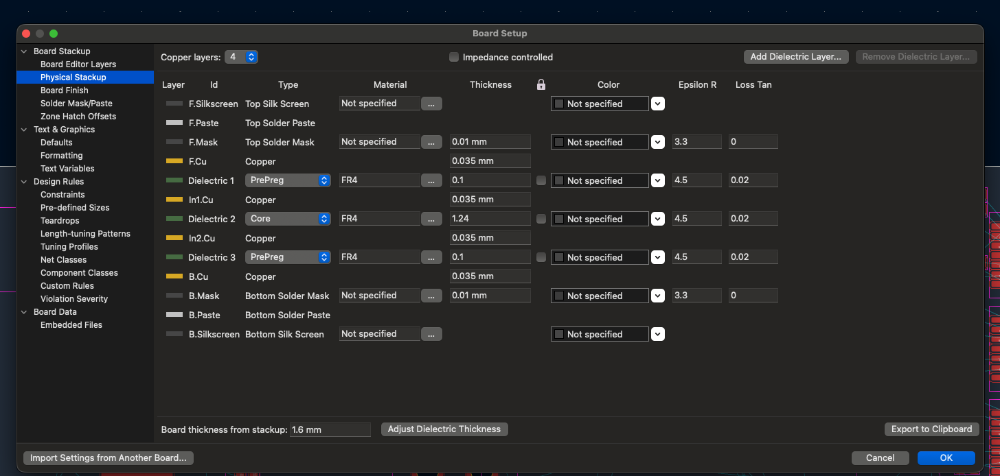
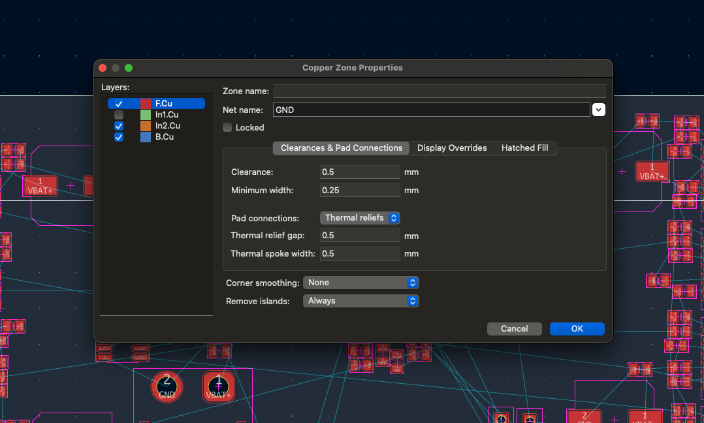
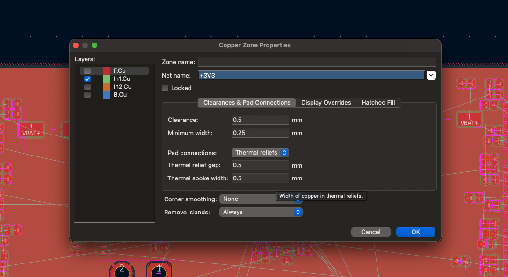
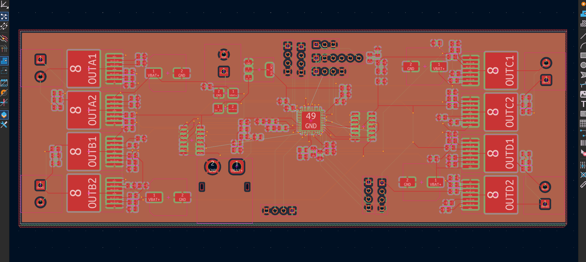
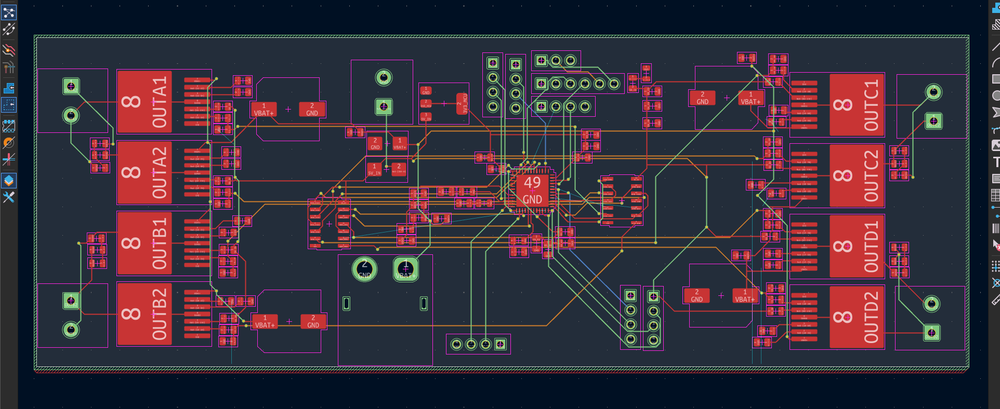
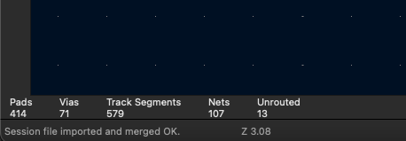

# Journal 15 — setting up four layers and importing more routing

i set the board to four copper layers with a total thickness of 1.6 mm  
the setup shows 0.035 mm copper on each layer and FR-4 between the layers

i set up a GND zone on F.Cu, B.Cu and In2.Cu  
the screenshot shows 0.5 mm clearance, 0.25 mm minimum width and 0.5 mm thermal gaps and spokes

i set In1.Cu to the +3V3 net in the copper zone settings  
i still need to verify that this is the intended powered 3.3 V net, since the regulator output was labelled 3V3_MCU earlier

i filled the zones and checked how they covered the board around the drivers, controller and connectors

i imported a routing session and KiCad reported that it merged successfully  
the routing view shows tracks from the centre to the drivers and headers on several layers

the last screenshot shows 579 track segments and 71 vias, with 414 pads and 107 nets  
there are 13 unrouted connections left, down from 91 after the earlier fill, with 327 more track segments and 66 more vias compared with Journal 14  
the routing import is in the KiCad history copy, i still need to save the latest board to the main PCB file, finish the remaining connections and run DRC

