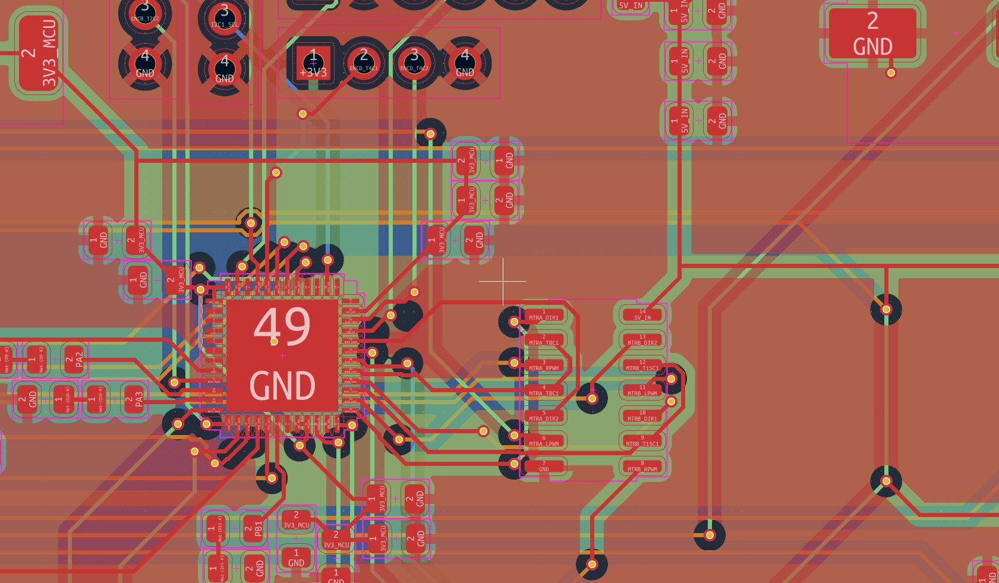
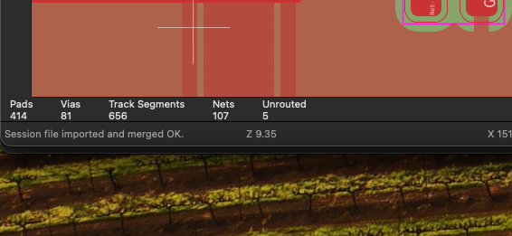
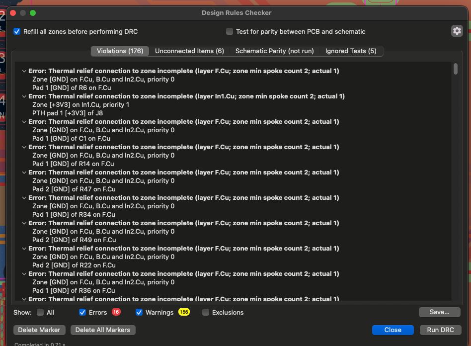
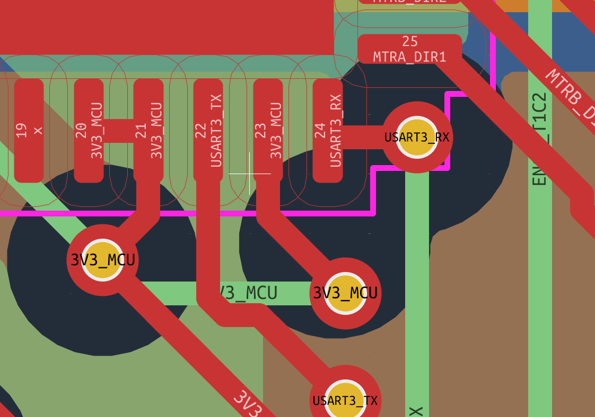
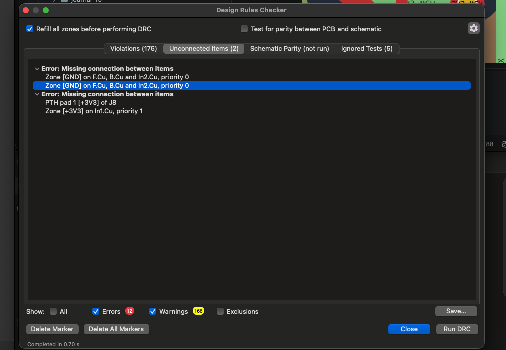
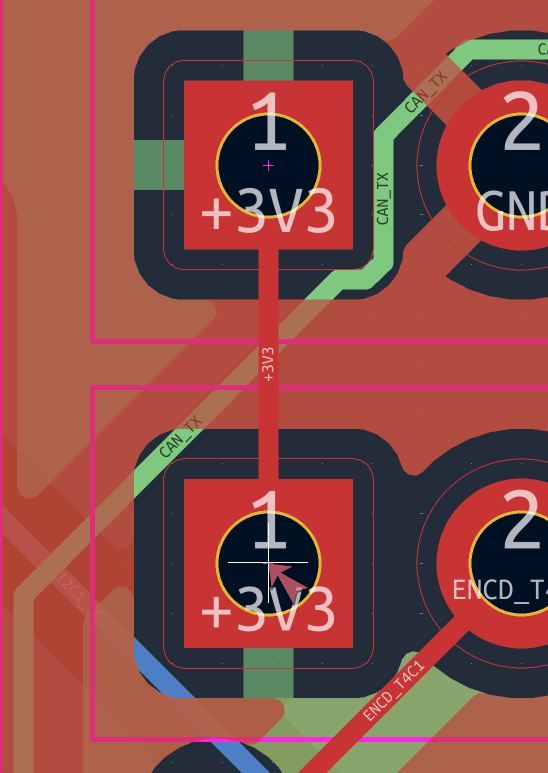
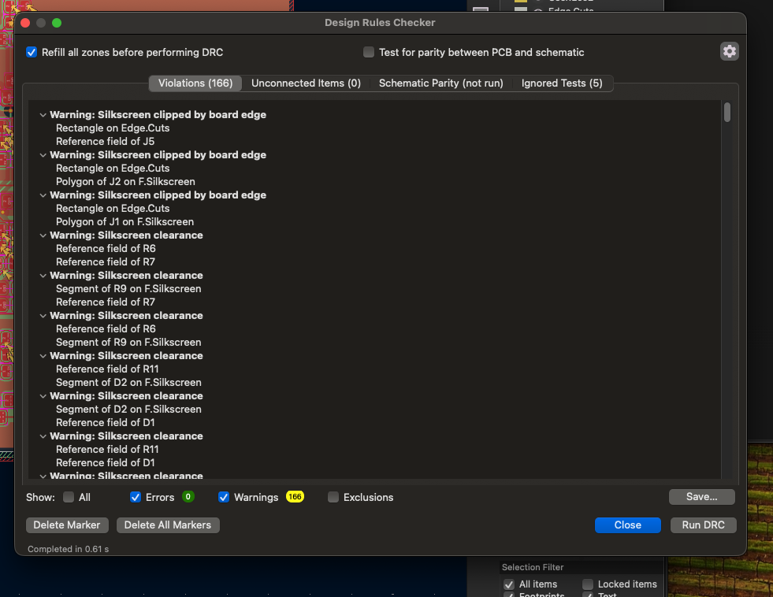

# Journal 16 — finishing routing and checking the board

i continued routing the connections around the STM32, the tracks around the small pads were getting crowded so i checked them close up

after another routing session import the board showed 666 track segments and 81 vias, with 5 unrouted connections left

this was 87 more segments and 10 more vias than the last journal

i ran the design rule checker and it still showed missing connections and incomplete thermal reliefs, the first check had 6 unconnected items and 166 warnings

i worked around the MCU power pins and UART tracks, the close view helped me see the vias and how the 3V3_MCU tracks reached the pads

another check brought the unconnected items down to 2, one was between ground zones and the other was between J8 and the +3V3 zone

i checked the +3V3 connection between the headers and worked on the copper connections around these pads

after fixing the remaining connections and thermal relief problems, the last check showed 0 errors and 0 unconnected items

there were still 166 warnings including silkscreen clearance and silkscreen clipped by the board edge, schematic parity was not run and 5 tests were ignored, so those checks still need attention

