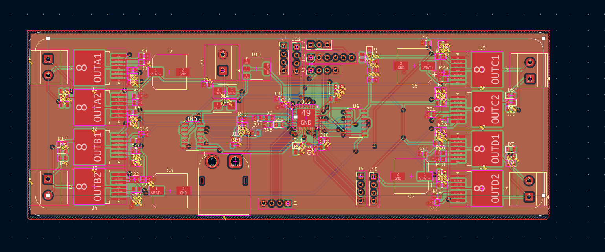
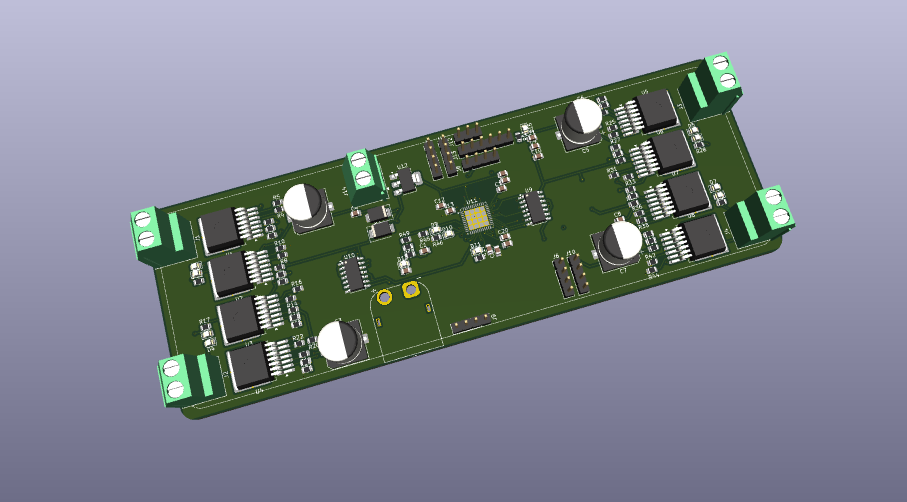
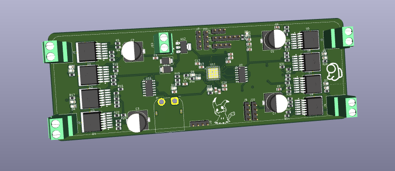
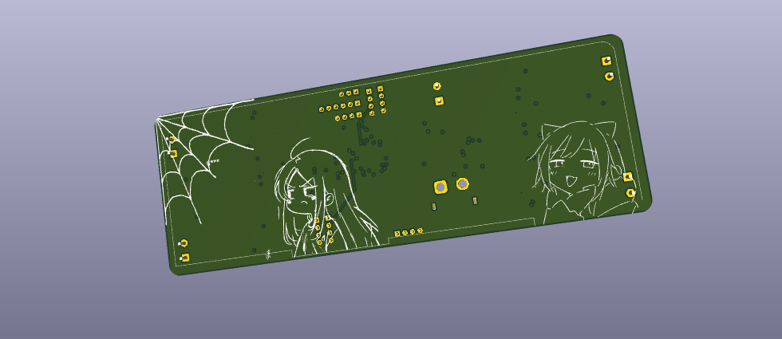
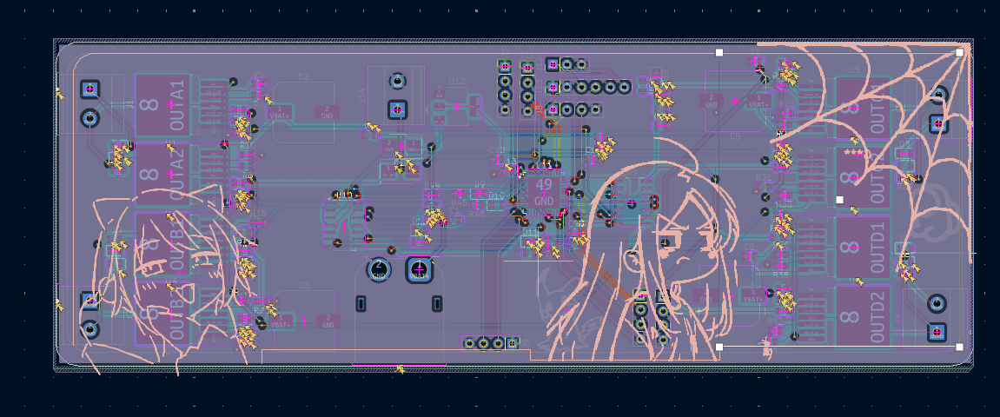
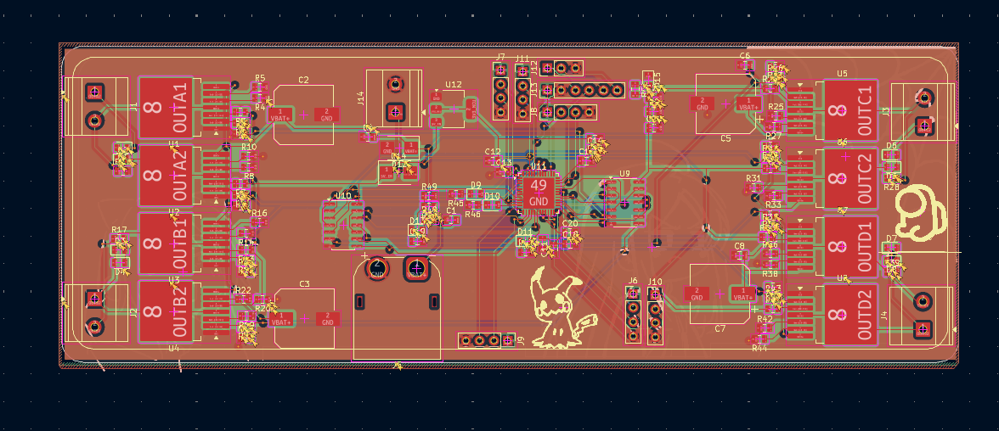

# Journal 17 — adding artwork and checking the 3d board

i looked over the routed board as a whole, the four motor sections sit along the sides with the controller and logic in the middle

i opened the 3d viewer to see the drivers, large capacitors and connectors together, this made it easier to look at the spacing and board shape

i added small drawings to the front silkscreen and checked how they looked with the parts in the 3d view

i added larger character drawings and a web design on the back, then turned the board over in the viewer to check how the artwork looked around the holes

i checked the back artwork in the PCB editor too, the pads and board outline are visible here so i could see where the drawings sit

the last screenshot shows the front artwork with the routing and component outlines

these are design previews, i still need to check the silkscreen clearances again after adding the drawings

