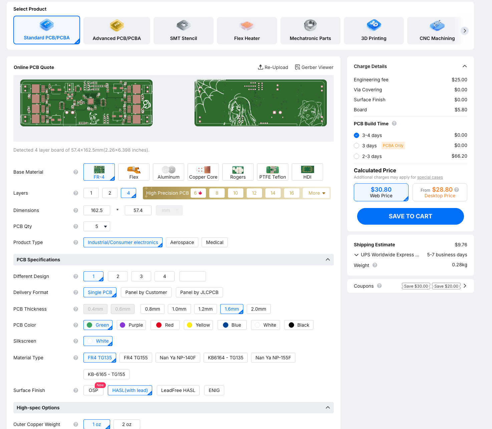
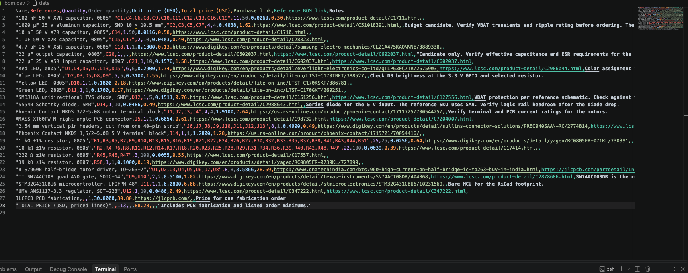

# Journal 18 — checking the pcb quote and making the bom

i uploaded the board files to JLCPCB and checked the preview of both sides

the quote shows a four layer board around 162.5 by 57.4 mm, with 5 boards selected and 1.6 mm thickness, green solder mask and white silkscreen

the web price shown was 30.80 USD, made up of 25 USD engineering fee and 5.80 USD board cost, shipping was shown separately

i made the bom using the KiCad parts list and the earlier reference bom, it has names, references, board quantities, order quantities, unit prices and purchase links

i kept the order quantity visible because some parts come with a minimum order, the file covers 113 components and includes the 30.80 USD PCB order

the priced total came to 88.28 USD, C20 still needs its capacitor requirements checked and shipping and extra taxes are outside this total

this gives me a parts budget for the design, the screenshots show the quote and bom stage and the hardware is still to be built

