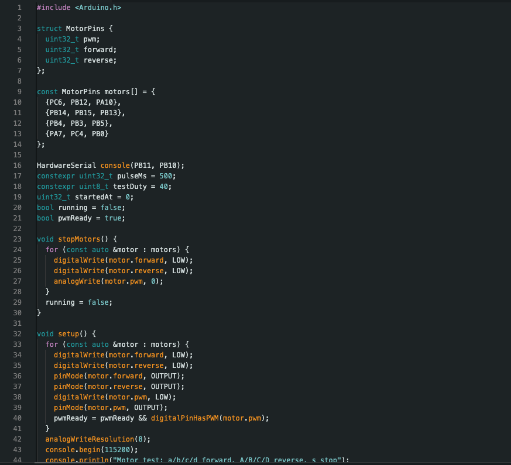
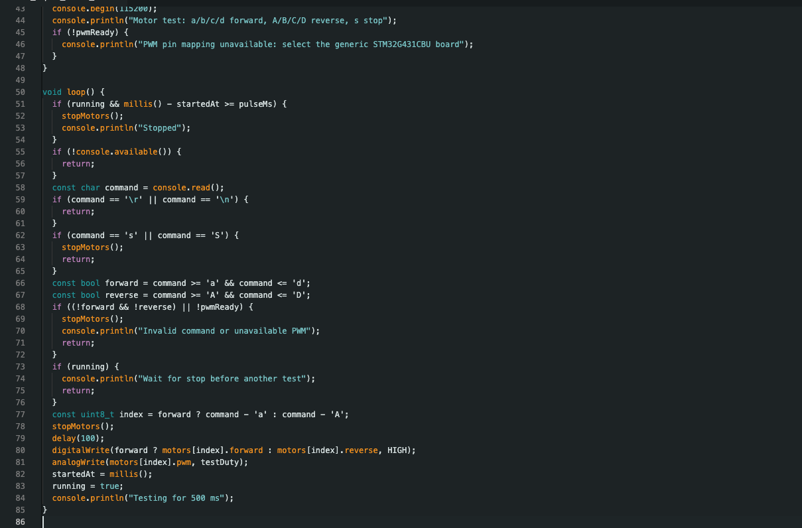
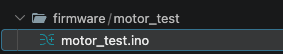

# Journal 19 — making the motor test firmware

i put together a small STM32 Arduino sketch to test the four motor outputs when the board is ready

each motor has one PWM pin and two direction pins, i used the pin names from the pcb so the sketch matches channels A to D

at startup the sketch sets the motor control pins low and checks that the selected board supports PWM on all four pins, the UART opens at 115200 baud

the test starts when i send a letter over UART, `a` to `d` pick a motor and run it forward, uppercase `A` to `D` run it in reverse

each command runs one motor for 500 ms at about 16 percent PWM, then the sketch clears the direction and PWM signals, i can also send `s` to stop it early

i saved the sketch as [motor_test.ino](../../firmware/motor_test/motor_test.ino) in the firmware folder

the screenshots show the code and where it lives, compiling it for the STM32 and trying it on the actual board are still pending

