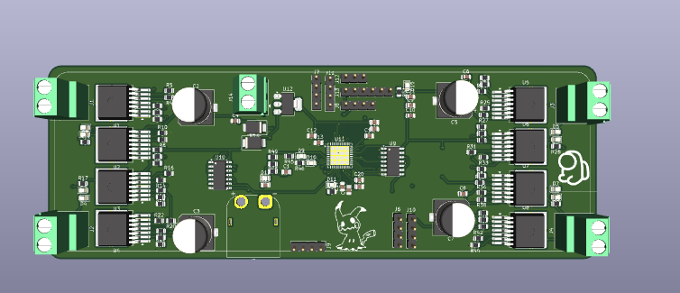
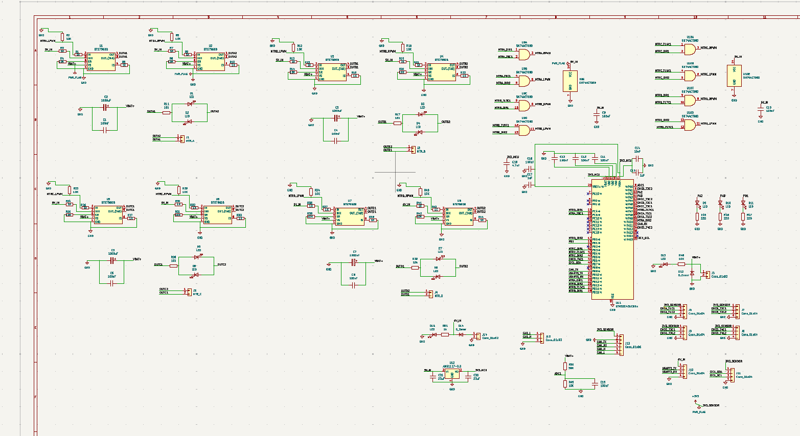
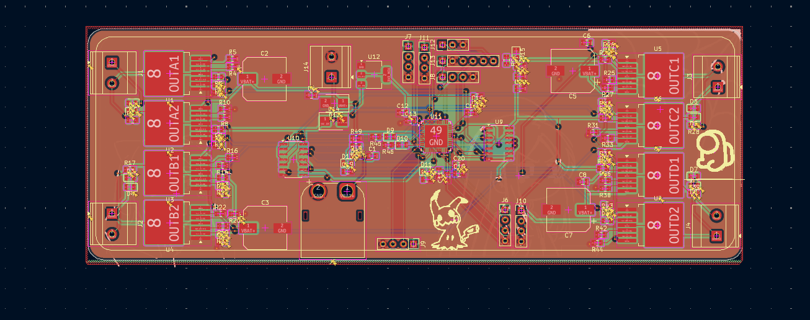
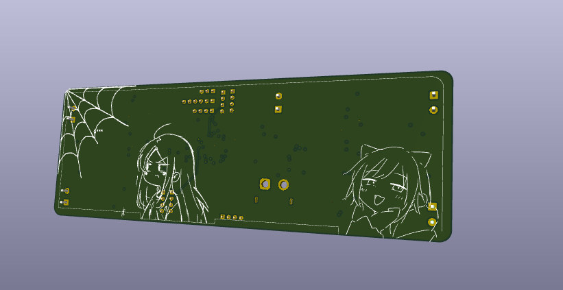
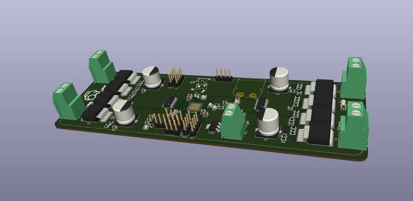

# STM32 Four Motor Driver

In my motor driver board, there is an STM32G431CBU6 with eight BTS7960B ICs to drive the four brushed DC motors.
I designed the circuit schematic and 4-layer PCB in KiCad, put artwork on both sides and wrote a simple Arduino sketch to check the hardware for the first time.

The repository contains the circuit schematic, PCB layout, Gerber files, parts list and demo firmware.
The board is currently in the design phase and needs to be assembled and tested.

## how it works

Each motor is connected between the outputs of two BTS7960B half-bridges
The STM32 provides one PWM signal and two direction signals per channel, which are combined using SN74ACT08 gates before going to the driver's inputs

The battery for the motors is plugged in via the XT60 connector, whereas the logic input is fed from 5V_IN
AMS1117-3.3 generates 3V3_MCU power supply for STM32

~~~text
STM32 PWM + direction --> SN74ACT08 gates --> BTS7960B pairs --> four motors
battery input --> motor supply
logic input --> 5V_IN --> AMS1117-3.3 --> STM32
encoder headers --> STM32
STM32 --> UART, I2C and external CAN transceiver header
~~~

there are four encoder connectors, a battery voltage divider, and three status LEDs in the circuit diagram.
the CAN bus requires a header connector that connects to an external transceiver module, but it is yet to be chosen.

## main features

- Four channels of motor control with two BTS7960B ICs on each channel
- Bare STM32G431CBU6 microcontroller in QFN packaging
- Two SN74ACT08 logic ICs for PWM and direction control of the motors
- 4-layer PCB approximately 162.5 x 57.4mm in size with a 1.6mm board thickness
- Screw terminal for motor outputs and XT60 footprint for battery input
- Connections to encoder, UART, I2C, and CAN module
- Front and back silkscreen printing
- UART controlled demo firmware with small motor pulses

## images

**full schematic**

**routed PCB**

**back artwork**

**angled board view**

these images are KiCad design previews, physical fit and operation still need checking on the assembled board

## how i plan to build it

1. check the supply connections, programming access and any remaining schematics and PCB checks
2. check that all BOM parts fit their footprints and select the regulator output capacitor
3. recreate and verify the Gerber and drill files following any modifications to the PCB
4. assemble the power and control boards and verify the supply rail voltages
5. program the demo using SWD and verify the control signals
6. test each motor channel one at a time using a current limited power supply

## firmware demo

open [motor_test.ino](firmware/motor_test/motor_test.ino) with the STM32duino Arduino core and select the generic STM32G431CBU board
the sketch uses the saved PCB pin mapping

| motor | PWM | direction 1 | direction 2 |
|---|---|---|---|
| A | PC6 | PB12 | PA10 |
| B | PB14 | PB15 | PB13 |
| C | PB4 | PB3 | PB5 |
| D | PA7 | PC4 | PB0 |

The UART console will use PB10 as TX and PB11 as RX at 115200 baud
Connect a 3.3 V USB-UART adapter where RX connects to PB10, TX to PB11 and GND to ground of the board

Send “a”, “b”, “c” or “d” to move forward and “A”, “B”, “C” or “D” to move backwards
Each command initiates one 500 ms pulse with a PWM value of 40/255 which is equal to 16%
Use “s” to stop before completion. The sketch begins with all outputs set to LOW

The demo sketch has yet to be compiled and tested on hardware, more tests with encoders and communication will be done later on

[STM32duino core and supported boards](https://github.com/stm32duino/Arduino_Core_STM32)

## what is in the repo

~~~text
.
├── firmware/motor_test/  Arduino motor test sketch
├── gerber/              PCB layers and drill files
├── gerber.zip           Fabrication archive
├── image/               Final project views and preserved originals
├── journal/             Individual devlogs and original screenshots
├── journal image/       Images used by the combined journal
├── kicad/               Schematic, PCB and project symbol library
├── bom.csv              Parts, quantities, prices and purchase links
├── JOURNAL.md           Combined development journal
└── readme.md            Project overview
~~~

## parts and BOM

the budget cost of the current parts is **$88.28 USD**, which includes the **PCB** at **$30.80** for five boards
the component totals refer to one board, while the orders include the quantities of components due to the vendor’s minimums
one 40-pin strip is ordered for cutting into eight headers

the prices are from the BOM estimates, with the conversion rate for ₹93.765 per USD for BTS7960
the shipping charges, additional taxes and the purchase of the C20 if necessary have to be added
C20 has a candidate link while the regulator compatibility check is underway

| board qty | order qty | part | unit price (USD) | cost (USD) | source |
|---:|---:|---|---:|---:|---|
| 11 | 50 | 100 nF 50 V X7R capacitor, 0805 | $0.0060 | $0.30 | [listing](https://www.lcsc.com/product-detail/C1711.html) |
| 4 | 4 | 1000 µF 25 V aluminum capacitor, SMD 10 × 10.5 mm | $0.4038 | $1.62 | [listing](https://www.lcsc.com/product-detail/C51018391.html) |
| 1 | 50 | 10 nF 50 V X7R capacitor, 0805 | $0.0116 | $0.58 | [listing](https://www.lcsc.com/product-detail/C1710.html) |
| 2 | 10 | 1 µF 50 V X7R capacitor, 0805 | $0.0403 | $0.40 | [listing](https://www.lcsc.com/product-detail/C28323.html) |
| 1 | 1 | 4.7 µF 25 V X5R capacitor, 0805 | $0.1300 | $0.13 | [listing](https://www.digikey.com/en/products/detail/samsung-electro-mechanics/CL21A475KAQNNNE/3889330) |
| 1 | pending | 22 µF output capacitor, 0805 | pending | pending | [listing](https://www.lcsc.com/product-detail/C602037.html) |
| 1 | 10 | 22 µF 25 V X5R input capacitor, 0805 | $0.1576 | $1.58 | [listing](https://www.lcsc.com/product-detail/C602037.html) |
| 6 | 6 | Red LED, 0805 | $0.2900 | $1.74 | [listing](https://www.digikey.com/en/products/detail/everlight-electronics-co-ltd/QTLP630C7TR/2675903) |
| 5 | 5 | Blue LED, 0805 | $0.3100 | $1.55 | [listing](https://www.digikey.com/en/products/detail/liteon/LTST-C170TBKT/388527) |
| 1 | 1 | Yellow LED, 0805 | $0.1800 | $0.18 | [listing](https://www.digikey.com/en/products/detail/lite-on-inc/LTST-C170KSKT/386781) |
| 1 | 1 | Green LED, 0805 | $0.1700 | $0.17 | [listing](https://www.digikey.com/en/products/detail/lite-on-inc/LTST-C170GKT/269251) |
| 1 | 5 | SMBJ18A unidirectional TVS diode, SMB | $0.1511 | $0.76 | [listing](https://www.lcsc.com/product-detail/C151256.html) |
| 1 | 10 | SS54B Schottky diode, SMB | $0.0486 | $0.49 | [listing](https://www.lcsc.com/product-detail/C2988643.html) |
| 4 | 4 | Phoenix Contact MKDS 3/2-5.08 motor terminal block | $1.9100 | $7.64 | [listing](https://us.rs-online.com/product/phoenix-contact/1711725/70054425/) |
| 1 | 1 | AMASS XT60PW-M right-angle PCB connector | $0.6054 | $0.61 | [listing](https://www.lcsc.com/product-detail/C98732.html) |
| 8 | 1 | 2.54 mm vertical pin headers, cut from one 40-pin strip | $0.4900 | $0.49 | [listing](https://www.digikey.com/en/products/detail/sullins-connector-solutions/PREC040SAAN-RC/2774814) |
| 1 | 1 | Phoenix Contact MKDS 1,5/2-5.08 5 V terminal block | $1.2800 | $1.28 | [listing](https://us.rs-online.com/product/phoenix-contact/1715721/70054416/) |
| 25 | 25 | 1 kΩ ±1% resistor, 0805 | $0.0256 | $0.64 | [listing](https://www.digikey.com/en/products/detail/yageo/RC0805FR-071KL/730391) |
| 22 | 100 | 10 kΩ ±1% resistor, 0805 | $0.0039 | $0.39 | [listing](https://www.lcsc.com/product-detail/C17414.html) |
| 3 | 100 | 220 Ω ±1% resistor, 0805 | $0.0055 | $0.55 | [listing](https://www.lcsc.com/product-detail/C17557.html) |
| 1 | 1 | 39 kΩ ±1% resistor, 0805 | $0.1000 | $0.10 | [listing](https://www.digikey.com/en/products/detail/yageo/RC0805FR-0739KL/727899) |
| 8 | 8 | BTS7960B half-bridge motor driver, TO-263-7 | $3.5866 | $28.69 | [listing](https://www.dnatechindia.com/bts7960-high-current-pn-half-bridge-ic-to263-buy-in-india.html) |
| 2 | 2 | TI SN74ACT08 quad AND gate, SOIC-14 | $0.5100 | $1.02 | [listing](https://www.digikey.com/en/products/detail/texas-instruments/SN74ACT08DR/404868) |
| 1 | 1 | STM32G431CBU6 microcontroller, UFQFPN-48 | $6.0800 | $6.08 | [listing](https://www.digikey.com/en/products/detail/stmicroelectronics/STM32G431CBU6/10231569) |
| 1 | 10 | UMW AMS1117-3.3 regulator, SOT-223 | $0.0486 | $0.49 | [listing](https://www.lcsc.com/product-detail/C347222.html) |
| — | 1 | JLCPCB PCB fabrication | $30.8000 | $30.80 | [listing](https://jlcpcb.com/) |
| | | **total for priced items** | | **$88.28** | |

## PCB files and current checks

- [KiCad project](kicad/Untitled.kicad_pro)
- [schematic](kicad/Untitled.kicad_sch)
- [PCB layout](kicad/Untitled.kicad_pcb)
- [project symbol library](kicad/Motor_Driver.kicad_sym)
- [Gerber and drill archive](gerber.zip)
- [individual fabrication files](gerber/)

## reference

i used the STM32G431CBU6 motor driver schematic by Rido Alin F, shown in the EasyEDA reference, as the starting point
my KiCad version uses the bare STM32 chip, with its power wiring and the PCB layout recorded in the journal
# -motor-driver
